# ad-gpo-automation

Laboratorio de Active Directory **definido como código**: un bosque con dos dominios, un servidor miembro, DNS, OU y usuarios de prueba, creados desde cero con Vagrant (VMware) y Ansible (`microsoft.ad`, `ansible.windows`).
Aquí voy contando paso a paso cómo lo he montado y los problemas que me encontré.

## Qué crea

| Máquina | IP del lab | Sistema | Papel |
|---|---|---|---|
| DC01 | 192.168.56.10 | Windows Server 2022 (escritorio) | DC raíz del bosque `lab.local`, DNS |
| DC02 | 192.168.56.11 | Windows Server 2022 Core | DC del dominio hijo `emea.lab.local`, DNS |
| SRV01 | 192.168.56.20 | Windows Server 2022 Core | servidor miembro de `lab.local`, en `OU=Servidores` |

Además: zona DNS inversa, reenviadores, aging y scavenging; papelera de reciclaje de AD; 8 OU, 3 grupos y 6 usuarios de prueba.

**Montarlo de una vez:** ver [Recrear el lab desde cero](#recrear-el-lab-desde-cero).

## Hoja de ruta

**Montaje del entorno** (sección [Cómo he montado el entorno](#cómo-he-montado-el-entorno))

- [x] Paso 1 — Herramientas en el host
- [x] Paso 2 — Repositorio Git y estructura del proyecto
- [x] Paso 3 — Primera VM: DC01 con Vagrant
- [x] Paso 4 — Nodo de control Ansible en WSL y primer `win_ping`
- [x] Paso 5 — Inventario y credenciales cifradas con Ansible Vault
- [x] Paso 6 — Promoción de DC01 a controlador de dominio (`lab.local`) con Ansible
- [x] Paso 7 — DC02: dominio hijo `emea.lab.local`
- [x] Paso 8 — SRV01: servidor miembro unido al dominio
- [x] Paso 9 — DNS como código
- [x] Paso 10 — OU, grupos, usuarios de prueba y papelera de reciclaje
- [x] Paso 11 — Recrear el lab desde cero con un solo playbook
- [ ] Prueba completa: `vagrant destroy` y reconstrucción con `site.yml`

## Cómo he montado el entorno

### Paso 1 — Herramientas en el host

**Mi equipo:** Windows 11 Home, i7-13700HX, 32 GB de RAM, con WSL2 (Ubuntu 24.04) ya funcionando.

Windows 11 Home no trae Hyper-V Manager, así que las VMs del lab las monto con **VMware Workstation Pro** y las defino con **Vagrant**, para poder recrearlas cuando quiera. Además he instalado **Docker Desktop** (usa WSL2 como backend) y **Git**.

Vagrant, Docker y Git, con `winget` desde una PowerShell como administrador:

```powershell
winget install -e --id Hashicorp.Vagrant
winget install -e --id Docker.DockerDesktop
winget install -e --id Git.Git
```

VMware Workstation Pro (gratuito para uso personal) y la **Vagrant VMware Utility** se instalan con sus instaladores oficiales. La utilidad es un servicio de Windows (`VagrantVMware`) que hace de puente entre Vagrant y VMware. Después, el plugin de Vagrant:

```powershell
vagrant plugin install vagrant-vmware-desktop
```

Versiones instaladas (octubre 2026):

| Herramienta | Versión |
|---|---|
| VMware Workstation Pro | 26.0.1 |
| Vagrant | 2.4.9 |
| Plugin `vagrant-vmware-desktop` | 3.0.5 |
| Vagrant VMware Utility | 1.0.24 |
| Docker Desktop | 4.94.0 (Docker Engine 29.8.2) |
| Git | 2.55.0.windows.3 |
| WSL | Ubuntu-24.04, versión 2 |

Con WSL2 y Docker, el hipervisor de Windows está siempre activo, y no se puede quitar sin perderlos a los dos (y en WSL2 vive Ansible). Así que el hipervisor de las VMs tiene que convivir con él: VMware Workstation lo hace a través de **Windows Hypervisor Platform**, que activé junto con la plataforma de máquina virtual:

```powershell
dism /online /enable-feature /featurename:HypervisorPlatform /all /norestart
dism /online /enable-feature /featurename:VirtualMachinePlatform /all /norestart
```

Las dos órdenes terminaron con *"La operación se completó correctamente"*. Después **reinicié** el equipo (con `/norestart` no se aplican hasta reiniciar).

Lo comprobé también de forma gráfica: **Windows + R → `optionalfeatures`**. En la lista aparecen marcadas:

- [x] Plataforma de máquina virtual
- [x] Plataforma del hipervisor de Windows

O desde PowerShell como administrador:

```powershell
Get-WindowsOptionalFeature -Online |
  Where-Object FeatureName -in 'HypervisorPlatform','VirtualMachinePlatform' |
  Select-Object FeatureName, State
```

Las dos deben salir en estado `Enabled`.

Para comprobar que todo estaba bien instalado, preparé un script que muestra todas las versiones de una vez ([`scripts/Test-LabTools.ps1`](scripts/Test-LabTools.ps1)):

```powershell
powershell -ExecutionPolicy Bypass -File .\scripts\Test-LabTools.ps1
```

También se puede comprobar herramienta por herramienta:

```powershell
(Get-Item "C:\Program Files\VMware\VMware Workstation\vmware.exe").VersionInfo.ProductVersion
vagrant --version
vagrant plugin list
Get-Service VagrantVMware          # debe estar Running
docker --version
git --version
wsl -l -v
```

Notas de este paso:

- **Docker Desktop:** lo abrí una vez para aceptar la licencia y activé *Settings → Resources → WSL Integration → Ubuntu-24.04*.
- **Si no se reconoce `vagrant` o `docker`:** me pasó con `docker` ("El término 'docker' no se reconoce..."). Docker estaba bien instalado y su ruta (`C:\Program Files\Docker\Docker\resources\bin`) ya estaba en el PATH del sistema, pero la terminal se había abierto antes de la instalación. Se arregla cerrando y abriendo la terminal, o recargando el PATH en la misma sesión:

  ```powershell
  $env:Path = [Environment]::GetEnvironmentVariable('Path','Machine') + ';' + [Environment]::GetEnvironmentVariable('Path','User')
  ```

#### Problemas que me encontré

**La Vagrant VMware Utility no reconoce VMware Workstation 26.** Primero el instalador `.msi` se negaba a instalar (*requires a valid installation of VMware Workstation*) aunque Workstation estaba instalado; después, el servicio `VagrantVMware` no arrancaba, y su log (`C:\ProgramData\HashiCorp\vagrant-vmware-desktop\logs\utility.log`) decía:

```
[ERROR] failed to generate VMware installation information: error="El sistema no puede encontrar el archivo especificado."
```

La causa: Workstation 26 es la primera versión totalmente de 64 bits y registra su instalación en la vista de 64 bits del registro (`HKLM\SOFTWARE\VMware, Inc.`), mientras que la utilidad 1.0.24 solo la busca en la vista de 32 bits (`WOW6432Node`). Es un fallo conocido ([issue #177](https://github.com/hashicorp/vagrant-vmware-desktop/issues/177), con arreglo propuesto en el [PR #182](https://github.com/hashicorp/vagrant-vmware-desktop/pull/182)). Mientras no se publique, lo resuelve copiar la clave y añadir el valor `Core` (PowerShell como administrador):

```powershell
reg copy "HKLM\SOFTWARE\VMware, Inc.\VMware Workstation" "HKLM\SOFTWARE\WOW6432Node\VMware, Inc.\VMware Workstation" /s /f
reg add  "HKLM\SOFTWARE\WOW6432Node\VMware, Inc." /v Core /t REG_SZ /d "VMware Workstation" /f
net start VagrantVMware
```

Con solo la copia de la clave, el instalador ya acepta Workstation, pero el servicio no arranca: hace falta también `Core`. Cuando funciona, el log termina con `api service start: host=127.0.0.1 port=9922`. Por el camino también usé *Restore Defaults* en el Editor de red virtual para regenerar las redes VMnet.

### Paso 2 — Repositorio Git y estructura del proyecto

Creé las carpetas del proyecto (vacías por ahora, con un `.gitkeep` para que Git las guarde) e inicialicé el repositorio:

```powershell
git init -b main
git add -A
git commit -m "Paso 1 y 2: herramientas del host y estructura del proyecto"
```

Añadí dos ficheros de configuración:

- **`.gitignore`:** deja fuera la carpeta `.vagrant/` de las VMs, las contraseñas del vault de Ansible (`.vault_pass*`) y el entorno virtual de Python (`.venv/`). **Las credenciales nunca se suben al repo.**
- **`.gitattributes`:** los ficheros de Ansible (YAML) usan finales de línea LF, porque Ansible se ejecuta desde WSL (Linux), y los scripts de PowerShell usan CRLF.

### Paso 3 — Primera VM: DC01 con Vagrant

**Imagen base.** Vagrant no instala Windows desde una ISO: usa una *box*, una VM ya instalada y preparada. Uso la de Windows Server 2022 Standard (evaluación) de `gusztavvargadr`, que trae WinRM habilitado y el usuario `vagrant`/`vagrant`:

```powershell
vagrant box add gusztavvargadr/windows-server-2022-standard --provider vmware_desktop --box-version 2607.0.0
vagrant box list
```

**Red del lab.** Antes de crear la VM, en el *Editor de red virtual* de VMware (como administrador) creé la red **VMnet1**: host-only, `192.168.56.0/24`, **sin DHCP**. El equipo tiene la `192.168.56.1` y cada VM una IP fija (ver problemas 2 y 3).

**Vagrantfile.** Define la VM DC01 con IP fija en la red del lab:

```ruby
Vagrant.configure("2") do |config|
  config.vm.box          = "gusztavvargadr/windows-server-2022-standard"
  config.vm.box_version  = "2607.0.0"        # versión fija: lab reproducible
  config.vm.communicator = "winrm"
  config.winrm.transport = :negotiate        # NTLM: sigue funcionando tras promover a DC
  config.vm.boot_timeout = 1800
  config.vm.synced_folder ".", "/vagrant", disabled: true
  config.vm.provision "lab-tuning", type: "shell", path: "scripts/Optimize-LabGuest.ps1"

  config.vm.define "DC01" do |dc|
    dc.vm.hostname = "DC01"
    dc.vm.network "private_network", ip: "192.168.56.10"
    dc.vm.provision "lab-ip", type: "shell", path: "scripts/Set-LabIP.ps1", args: ["-IPAddress", "192.168.56.10"]
    dc.vm.provider "vmware_desktop" do |vm|
      vm.vmx["displayName"] = "lab-DC01"
      vm.memory       = 4096
      vm.cpus         = 2
      vm.gui          = false
      vm.linked_clone = true
    end
  end
end
```

Decisiones:

- **`transport = :negotiate`:** la autenticación *basic* solo funciona con cuentas locales. Al promover la VM a controlador de dominio desaparecen las cuentas locales y Vagrant dejaría de poder conectarse.
- **`private_network`:** además de la NIC NAT que crea Vagrant (salida a Internet, red `192.168.133.0/24` de VMware), una segunda NIC conectada a VMnet1. Esa es la red del lab, por la que entrará Ansible.
- **`linked_clone`:** la box se importa una sola vez como VM maestra y cada VM usa un disco diferencial. Ahorra disco y tiempo al crear DC02 y SRV01.
- **Provisioner `lab-ip`** ([`scripts/Set-LabIP.ps1`](scripts/Set-LabIP.ps1)): pone la IP fija en la NIC del lab (ver problema 4). Identifica la NIC NAT porque es la que tiene la ruta por defecto, y configura la otra. Es idempotente: si la IP ya está, no hace nada.
- **Provisioner `lab-tuning`** ([`scripts/Optimize-LabGuest.ps1`](scripts/Optimize-LabGuest.ps1)): desactiva Windows Update y el análisis en tiempo real de Defender. Así las VMs consumen menos CPU y disco. **Solo para el laboratorio.**

Para crearla:

```powershell
vagrant validate
vagrant up DC01 --provider vmware_desktop
```

#### Problemas que me encontré

**1. Errores de sintaxis en el Vagrantfile.** `vagrant validate` los detecta antes de crear nada:

- `syntax error, unexpected ':'` → había un punto en lugar de una coma: `"/vagrant". disabled:` en vez de `"/vagrant", disabled:`.
- `The following settings shouldn't exist: boot, synced, version, linked` → había escrito `boot.timeout` en lugar de `boot_timeout` (y lo mismo con `synced_folder`, `box_version` y `linked_clone`). Para Vagrant el punto separa niveles de configuración; el guion bajo forma parte del nombre.

**2. Vagrant no puede crear la red host-only** (`POST /vmnet` → `400`). Por eso VMnet1 se crea a mano en el Editor de red virtual, como se indica arriba.

**3. El equipo no llegaba a las VMs por VMnet1** (en `arp -a` aparecían como `Incomplete`). El adaptador virtual del equipo no tenía conectividad de capa 2. Se arregló reiniciando el adaptador y poniéndole la IP del equipo en la red del lab (PowerShell como administrador):

```powershell
Disable-NetAdapter -Name "VMware Network Adapter VMnet1" -Confirm:$false
Enable-NetAdapter  -Name "VMware Network Adapter VMnet1"
New-NetIPAddress -InterfaceAlias "VMware Network Adapter VMnet1" -IPAddress 192.168.56.1 -PrefixLength 24
```

Si vuelve a fallar la red del lab, es lo primero que miro: que VMnet1 tenga `192.168.56.1` y que `arp -a` resuelva las VMs.

**4. Vagrant no configura `private_network` en invitados Windows con VMware:**

```
Configuring secondary network adapters through VMware
on Windows is not yet supported. You will need to manually
configure the network adapter.
```

Lo resuelve el provisioner `lab-ip`. El `private_network` del Vagrantfile se queda, porque es lo que hace que VMware añada la segunda NIC conectada a VMnet1.

### Paso 4 — Nodo de control Ansible en WSL y primer contacto con DC01

Ansible no funciona de forma nativa en Windows, así que el nodo de control es mi Ubuntu 24.04 de WSL. Desde WSL el repo está en `/mnt/c/Users/vramo/ad-gpo-automation`.

**Comprobación de red.** Antes de instalar nada, verifiqué que WinRM de DC01 responde por la red del lab, primero desde Windows y luego desde WSL:

```powershell
Test-NetConnection 192.168.56.10 -Port 5985   # TcpTestSucceeded : True
```

```bash
nc -zv 192.168.56.10 5985
```

**Instalación en un entorno virtual de Python.** Así Ansible no se mezcla con los paquetes del sistema (Ubuntu 24.04 ya bloquea `pip install` en el Python del sistema):

```bash
sudo apt update && sudo apt install -y python3-venv python3-pip
python3 -m venv ~/.venvs/ansible
source ~/.venvs/ansible/bin/activate          # el prompt muestra (ansible)
pip install ansible pywinrm
ansible-galaxy collection install -r collections/requirements.yml
```

`collections/requirements.yml` fija la versión de cada colección (`ansible.windows` 3.8.0, `microsoft.ad` 1.12.1), para que el lab se monte igual dentro de un año.

Cada vez que abro una terminal nueva activo el entorno con `source ~/.venvs/ansible/bin/activate` (y `deactivate` para salir).

**Primer `win_ping`.** Una prueba ad-hoc, todavía sin inventario, pasando la conexión como variables:

```bash
ansible all -i '192.168.56.10,' -m ansible.windows.win_ping \
  -e ansible_connection=winrm \
  -e ansible_port=5985 \
  -e ansible_winrm_transport=ntlm \
  -e ansible_winrm_server_cert_validation=ignore \
  -e ansible_user=vagrant \
  -e ansible_password=vagrant
```

```
192.168.56.10 | SUCCESS => {
    "changed": false,
    "ping": "pong"
}
```

La cadena completa funciona: WSL → red host-only VMnet1 → WinRM → Windows Server. La coma de `-i '192.168.56.10,'` es necesaria: le dice a Ansible que es una lista de hosts y no la ruta a un fichero de inventario.

> Pasar la contraseña por la línea de comandos solo vale para esta prueba: queda en el historial de la shell. En el siguiente paso la conexión pasa a un inventario y la contraseña a Ansible Vault.

### Paso 5 — Inventario y credenciales cifradas con Ansible Vault

Pasar IP, usuario y contraseña en cada comando es incómodo, no escala y deja la contraseña en el historial de la shell. Lo sustituí por la estructura estándar de Ansible:

```
ansible.cfg                                 # valores por defecto del proyecto
inventories/lab/
├── hosts.yml                               # QUÉ máquinas hay y en qué grupos
└── group_vars/windows/
    ├── vars.yml                            # CÓMO conectarse (en claro)
    └── vault.yml                           # la contraseña (cifrada, AES-256)
```

**Inventario** (`inventories/lab/hosts.yml`):

```yaml
all:
  children:
    windows:
      children:
        domain_controllers:
          hosts:
            DC01:
              ansible_host: 192.168.56.10
```

DC01 está en `domain_controllers`, que está dentro de `windows`. Los grupos se heredan, así que DC01 recibe las variables de `group_vars/windows/`, y cualquier servidor que añada después al grupo `windows` también.

**Variables de conexión** (`inventories/lab/group_vars/windows/vars.yml`):

```yaml
ansible_connection: winrm
ansible_port: 5985
ansible_winrm_transport: ntlm
ansible_winrm_server_cert_validation: ignore
ansible_user: vagrant
ansible_password: "{{ vault_windows_password }}"
```

`ansible_password` no contiene la contraseña: es una referencia a una variable definida en el vault. Separar `vars.yml` (en claro) y `vault.yml` (cifrado) permite ver qué variables existen sin descifrar nada, y el prefijo `vault_` indica de dónde viene cada una.

**Vault.** La clave que descifra el vault se genera aleatoriamente y vive **fuera del repo**, en mi home de Linux, con permisos solo para mi usuario:

```bash
mkdir -p ~/.ansible
openssl rand -base64 32 > ~/.ansible/lab-vault-pass
chmod 600 ~/.ansible/lab-vault-pass

ansible-vault create --vault-password-file ~/.ansible/lab-vault-pass \
  inventories/lab/group_vars/windows/vault.yml
# contenido: vault_windows_password: <contraseña>
```

En el repo solo queda el fichero cifrado, que empieza por `$ANSIBLE_VAULT;1.1;AES256`. Para consultarlo o cambiarlo: `ansible-vault view` / `ansible-vault edit`.

**Configuración del proyecto** (`ansible.cfg`, en la raíz del repo):

```ini
[defaults]
inventory = inventories/lab/hosts.yml
vault_password_file = ~/.ansible/lab-vault-pass
host_key_checking = False
retry_files_enabled = False
interpreter_python = auto_silent
```

**Resultado.** El mismo `win_ping` del paso anterior, ahora sin IP, usuario ni contraseña en la línea de comandos:

```bash
ansible --version | grep "config file"     # config file = .../ad-gpo-automation/ansible.cfg
ansible windows -m ansible.windows.win_ping
```

```
DC01 | SUCCESS => {
    "changed": false,
    "ping": "pong"
}
```

#### Problemas que me encontré

**Ansible ignora el `ansible.cfg` en `/mnt/c`.** Por defecto WSL monta las unidades de Windows con permisos 777, y Ansible no lee un `ansible.cfg` en una carpeta en la que cualquiera puede escribir (sería una vía para inyectar configuración). Se corrige en `/etc/wsl.conf`, y después `wsl --shutdown` desde PowerShell:

```ini
[automount]
options = "metadata,umask=22,fmask=11"
```

**`No inventory was parsed ... Could not match supplied host pattern: windows`.** Ansible no encontraba el inventario porque el `ansible.cfg` aún no existía. `ansible --version | grep "config file"` muestra qué fichero de configuración está usando (o `None`).

### Paso 6 — DC01 promovido a controlador de dominio de `lab.local` con Ansible

Primera automatización real: un rol de Ansible (`ad_forest`) que convierte un Windows Server recién creado en el primer controlador de dominio de un bosque nuevo. Es idempotente: si el dominio ya existe, no cambia nada.

**Datos del dominio** (`inventories/lab/group_vars/all/vars.yml`), comunes a todas las máquinas porque los servidores miembro los necesitarán para unirse:

```yaml
ad_domain_name: lab.local
ad_netbios_name: LAB
ad_forest_mode: WinThreshold      # nivel funcional Windows Server 2016
ad_domain_mode: WinThreshold
ad_lab_network: 192.168.56.0/24
```

**Contraseña DSRM** (*Directory Services Restore Mode*, la cuenta de emergencia del DC para restaurar AD cuando el servicio está parado). Está en `group_vars/domain_controllers/`, y no en `all/`, por mínimo privilegio: solo los DCs reciben ese secreto.

```
group_vars/domain_controllers/vars.yml   → ad_dsrm_password: "{{ vault_ad_dsrm_password }}"
group_vars/domain_controllers/vault.yml  → vault_ad_dsrm_password (cifrado)
```

**El rol** (`roles/ad_forest/tasks/main.yml`):

| # | Tarea | Módulo | Por qué |
|---|---|---|---|
| 1 | Las NIC que no son del lab no se registran en DNS | `win_powershell` | La VM tiene dos NIC: NAT (`192.168.133.x`, la de Vagrant) y la del lab. Si el DC registra la IP NAT, los clientes intentan contactar con una IP inalcanzable |
| 2 | Instalar el rol AD DS | `win_feature` | Requisito previo de la promoción |
| 3 | Reiniciar solo si hace falta | `win_reboot` + `when` | |
| 4 | Crear el bosque | `microsoft.ad.domain` | Equivale a `Install-ADDSForest`: crea `lab.local`, instala DNS y reinicia. `reboot_timeout: 1800` deja margen, porque el primer arranque como DC puede superar los 10 minutos que el módulo espera por defecto |
| 5 | Esperar a que AD responda | `win_powershell` + `until`/`retries` | Tras el reinicio AD tarda en estar disponible |
| 6 | Servidor DNS escuchando solo en la IP del lab | `win_powershell` | Ver problemas |
| 7 | Eliminar registros A fuera de la red del lab | `win_powershell` | Limpia `lab.local` y `_msdcs.lab.local` |

**El playbook** (`playbooks/01-deploy-forest.yml`) solo dice a quién se aplica:

```yaml
- name: Desplegar el bosque de Active Directory
  hosts: dc_root
  gather_facts: false
  roles:
    - ad_forest
```

`dc_root` es un subgrupo de `domain_controllers` que solo contiene a DC01; DC02 va en `dc_child` (ver Paso 7). Al principio el playbook apuntaba a `domain_controllers`, pero cuando añadí DC02 al inventario lo habría intentado convertir también en raíz de un bosque.

**Ejecución.** Antes, una simulación con `--check --diff` (el equivalente a un `terraform plan`), y después la ejecución real:

```bash
vagrant snapshot save DC01 00-base-limpia          # (PowerShell) punto de vuelta atrás
ansible-playbook playbooks/01-deploy-forest.yml --check --diff
ansible-playbook playbooks/01-deploy-forest.yml
```

**Verificación.** Un playbook de solo lectura (`playbooks/00-estado-dc.yml`) que muestra el estado del servidor y que reutilizo antes y después de cada cambio:

```
"Dominio": "lab.local",
"Rol": "Controlador de dominio (PDC)",
"AD_DS": "Installed",  "DNS": "Installed",
"NICs": [
    "Ethernet0  192.168.133.129  registra_en_DNS=False",
    "Ethernet1  192.168.56.10  registra_en_DNS=True"
]
```

Registros A de la zona `lab.local`, todos en la red del lab:

```
HostName       IP
--------       --
@              192.168.56.10
dc01           192.168.56.10
DomainDnsZones 192.168.56.10
ForestDnsZones 192.168.56.10
```

Una segunda ejecución del playbook termina con `changed=0`: el rol es idempotente. Las salidas están en `docs/evidencias/`.

#### Problemas que me encontré

**1. `The role 'ad_forest' was not found`.** Por defecto Ansible busca los roles junto al playbook (`playbooks/roles/`). Como separo `playbooks/` y `roles/` en la raíz del repo, hay que indicarlo en `ansible.cfg` con `roles_path = roles`. Además, el fichero de tareas tiene que llamarse `tasks/main.yml`; con otro nombre el rol no ejecuta nada.

**2. Erratas en nombres de módulos y variables** (`win_reeboot`, `reebot_required`). `--syntax-check` detecta un módulo inexistente, pero no una variable mal escrita, que solo falla al ejecutar. La extensión de Ansible para VS Code y `ansible-doc <módulo>` ayudan a evitarlas.

**3. `dc01.lab.local` registrado también con la IP NAT (`192.168.133.129`).** Aunque la tarea 1 desactiva el registro del *cliente* DNS en la NIC NAT, el *servidor* DNS registra un registro A por cada IP en la que escucha, y por defecto escucha en todas. Solución en el rol: limitar las IPs de escucha del servidor DNS a la del lab (`dnscmd /ResetListenAddresses`) y eliminar los registros A que apunten fuera de la red del lab. Lo detecté consultando la zona después de la promoción, no por un error: por eso la verificación forma parte del paso.

**4. La tarea 6 devolvía `changed` en cada ejecución (no era idempotente).** Lo detectó la segunda ejecución del playbook: la tarea reconfiguraba y reiniciaba el servicio DNS cada vez, aunque ya estuviera bien. El diagnóstico:

```bash
ansible DC01 -m ansible.windows.win_shell -a '(Get-DnsServerSetting -All).ListeningIPAddress | ForEach-Object { "$_ (" + $_.AddressFamily + ")" }'
# 192.168.56.10 ()      ← AddressFamily vacío: es un texto, no un objeto IPAddress
```

`ListeningIPAddress` devuelve las IPs como **texto**, no como objetos `IPAddress`. La comprobación usaba `$_.IPAddressToString`, que en un texto no existe y devolvía vacío, así que la comparación nunca coincidía. Solución: convertir a texto con `"$_"`, que funciona en los dos casos:

```powershell
$current = @((Get-DnsServerSetting -All).ListeningIPAddress | ForEach-Object { "$_" })
```

Ahora el playbook completo termina con `changed=0` en ejecuciones sucesivas.

**5. `--check` decía `changed` pero DC01 seguía en `WORKGROUP`.** La salida de la simulación marcaba como cambiadas *Instalar el rol AD DS* y *Crear el bosque*, y llegué a pensar que el dominio ya estaba creado. Es lo esperado, porque **`--check` solo simula**: informa de lo que cambiaría, pero no cambia nada. Ni siquiera la tarea *Esperar a que Active Directory responda* llega a ejecutarse (sale `ok` por su `changed_when: false`). Lo delataron dos detalles: la VM no se había reiniciado, aunque crear el bosque lleva `reboot: true`, y `00-estado-dc.yml` seguía mostrando `Servidor independiente`. Para saber si un cambio se aplicó de verdad hay que verificar el estado después, no fiarse de la salida de un `--check`.

**Bosque resultante** (`Get-ADForest`):

```
Name               : lab.local
ForestMode         : Windows2016Forest
Domains            : {lab.local}
GlobalCatalogs     : {DC01.lab.local}
SchemaMaster       : DC01.lab.local
DomainNamingMaster : DC01.lab.local
Sites              : {Default-First-Site-Name}
```

### Paso 7 — DC02: dominio hijo `emea.lab.local`

Segundo dominio del bosque: DC02 (Windows Server 2022 **Core**, sin escritorio) se convierte en el primer controlador de `emea.lab.local`, hijo de `lab.local`. Entre los dos dominios se crea automáticamente una confianza bidireccional y transitiva.

**Inventario.** Dentro de `domain_controllers` hay dos subgrupos, y el grupo decide qué tipo de dominio crea el rol:

```yaml
domain_controllers:
  children:
    dc_root:              # crea el bosque
      hosts:
        DC01: { ansible_host: 192.168.56.10 }
    dc_child:             # crea un dominio hijo
      hosts:
        DC02: { ansible_host: 192.168.56.11 }
```

**Variables del dominio hijo** (`group_vars/dc_child/vars.yml`):

```yaml
ad_child_name: emea
ad_dc_domain: "{{ ad_child_name }}.{{ ad_domain_name }}"     # emea.lab.local
ad_parent_dc: DC01

# Antes de promoverse, el DC hijo resuelve lab.local con DC01; después, también consigo mismo
ad_dns_servers:
  - "{{ hostvars[ad_parent_dc].ansible_host }}"
  - "{{ ansible_host }}"

# Crear un dominio hijo exige una cuenta de Enterprise Admins del bosque
ad_enterprise_admin_user: "vagrant@{{ ad_domain_name }}"
ad_enterprise_admin_password: "{{ vault_windows_password }}"
```

En `group_vars/dc_root/vars.yml`, `ad_dc_domain` es simplemente `lab.local`. Así las tareas comunes del rol usan `ad_dc_domain` sin saber en qué DC están.

**El rol `ad_forest` ampliado.** Las tareas nuevas o cambiadas solo se ejecutan en `dc_child` (`when: "'dc_child' in group_names"`):

| # | Tarea | Módulo | Raíz | Hijo |
|---|---|---|:-:|:-:|
| 1 | Las NIC que no son del lab no se registran en DNS | `win_powershell` | ✓ | ✓ |
| 2 | **Resolver DNS con el DC del dominio padre** | `win_powershell` | | ✓ |
| 3 | Instalar el rol AD DS | `win_feature` | ✓ | ✓ |
| 4 | Reiniciar solo si hace falta | `win_reboot` | ✓ | ✓ |
| 5 | Crear el bosque | `microsoft.ad.domain` | ✓ | |
| 6 | **Crear el dominio hijo** | `microsoft.ad.domain_child` | | ✓ |
| 7 | Esperar a que AD responda | `win_powershell` | ✓ | ✓ |
| 8 | Servidor DNS escuchando solo en la IP del lab | `win_powershell` | ✓ | ✓ |
| 9 | Eliminar registros A fuera de la red del lab (zonas `ad_dc_domain` y `_msdcs.lab.local`) | `win_powershell` | ✓ | ✓ |
| 10 | **Eliminar registros glue fuera de la red del lab en la zona del padre** (se ejecuta en DC01) | `win_powershell` + `delegate_to` | | ✓ |

La promoción del hijo:

```yaml
- name: Crear el dominio hijo {{ ad_dc_domain }}
  microsoft.ad.domain_child:
    dns_domain_name: "{{ ad_dc_domain }}"          # el padre se deduce del nombre
    domain_admin_user: "{{ ad_enterprise_admin_user }}"
    domain_admin_password: "{{ ad_enterprise_admin_password }}"
    safe_mode_password: "{{ ad_dsrm_password }}"
    domain_mode: "{{ ad_domain_mode }}"
    install_dns: true
    create_dns_delegation: true
    reboot: true
    reboot_timeout: 1800
  when: "'dc_child' in group_names"
```

**El playbook** (`playbooks/02-deploy-child-domain.yml`) tiene dos plays: primero prepara el bosque en DC01 y después promueve DC02:

```yaml
- name: Preparar el bosque para el dominio hijo
  hosts: dc_root
  gather_facts: false
  tasks:
    - name: La cuenta de automatización pertenece a Enterprise Admins
      microsoft.ad.group:
        name: Enterprise Admins
        members:
          add:
            - vagrant

- name: Desplegar el dominio hijo
  hosts: dc_child
  gather_facts: false
  roles:
    - ad_forest
```

**Bosque frente a dominio hijo**, lo que hace cada módulo por debajo:

| | Bosque (DC01) | Dominio hijo (DC02) |
|---|---|---|
| Módulo de Ansible | `microsoft.ad.domain` | `microsoft.ad.domain_child` |
| Cmdlet equivalente | `Install-ADDSForest` | `Install-ADDSDomain -DomainType ChildDomain` |
| Credenciales | Ninguna: el bosque aún no existe | Una cuenta de **Enterprise Admins** |
| Requisito de red | — | Resolver por DNS el dominio padre |
| Nivel funcional | Del bosque y del dominio | Solo del dominio (≥ el del bosque) |
| DNS | Crea `lab.local` y `_msdcs.lab.local` | Crea `emea.lab.local` y la delegación `emea` en `lab.local` |

**Ejecución:**

```powershell
vagrant up DC02 --provider vmware_desktop
vagrant snapshot save DC02 00-base-limpia
```

```bash
ansible-playbook playbooks/02-deploy-child-domain.yml --check
ansible-playbook playbooks/02-deploy-child-domain.yml
```

**Verificación.** `Get-ADForest` devuelve lo mismo desde DC01 y desde DC02:

```
Name               : lab.local
ForestMode         : Windows2016Forest
Domains            : {emea.lab.local, lab.local}
GlobalCatalogs     : {DC01.lab.local, DC02.emea.lab.local}
SchemaMaster       : DC01.lab.local
DomainNamingMaster : DC01.lab.local
Sites              : {Default-First-Site-Name}
```

La confianza, comprobada desde DC02 con `nltest /sc_verify:lab.local`:

```
Trusted DC Name \\DC01.lab.local
Trusted DC Connection Status Status = 0 0x0 NERR_Success
Trust Verification Status = 0 0x0 NERR_Success
```

DNS: la delegación `emea` en `lab.local` apunta a `DC02.emea.lab.local`, y desde DC01 `dc02.emea.lab.local` resuelve solo a `192.168.56.11`. Dos ejecuciones seguidas de `01-deploy-forest.yml` y `02-deploy-child-domain.yml` terminan con `changed=0`. Las salidas están en `docs/evidencias/paso7-*.txt`.

**Salud de los DC.** Después de la promoción, en DC01:

```powershell
dcdiag /q
repadmin /replsummary
Get-ADTrust -Filter * | Select-Object Name, Direction, IntraForest, TrustAttributes, TrustType
```

La confianza con el hijo sale como debe: `Direction = BiDirectional`, `IntraForest = True`, `TrustAttributes = 32` (*within forest*) y `TrustType = Uplevel`. Es transitiva (`DisallowTransivity = False`): si añado otro hijo, confiará en `emea` a través de `lab.local`.

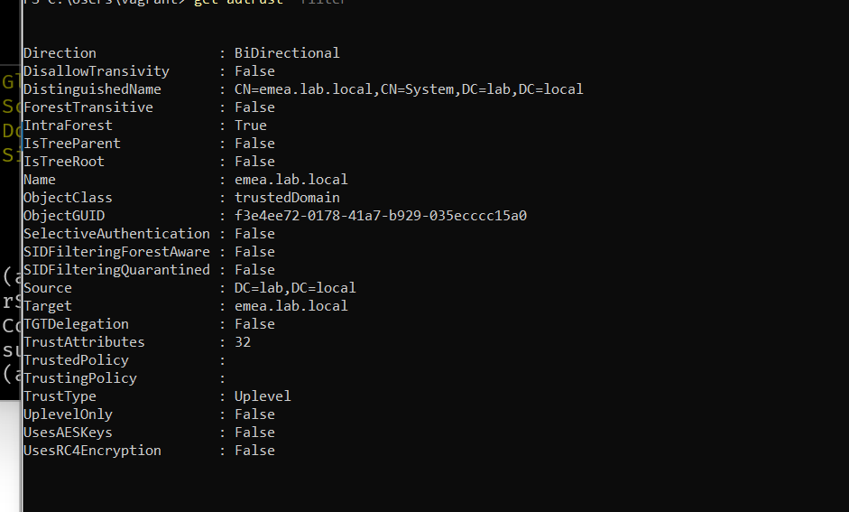

La replicación entre los dos DC, sin fallos:

```
Source DSA          largest delta    fails/total %%   error
 DC01                      39m:56s    0 /   4    0
 DC02                      34m:21s    0 /   4    0
```

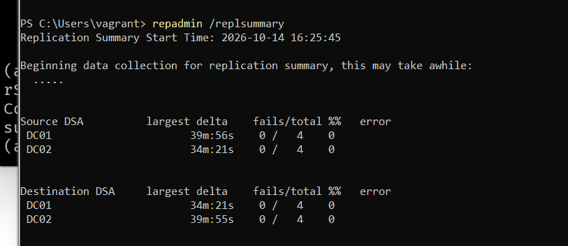

Aunque están en dominios distintos, DC01 y DC02 replican entre sí las particiones comunes del bosque (esquema, configuración y `ForestDnsZones`) y la parte del catálogo global. La partición de cada dominio solo se replica entre DCs del mismo dominio.

`dcdiag /q` solo muestra lo que falla, y salió un único aviso:

```
There are warning or error events within the last 24 hours after the SYSVOL has been shared.
......................... DC01 failed test DFSREvent
```

No es una avería. La prueba cuenta cualquier aviso o error del registro *DFS Replication* de las últimas 24 horas, aunque ya esté resuelto. En el registro (`Get-WinEvent -LogName "DFS Replication" -MaxEvents 15`) se ve la secuencia de la promoción: un error **1202** (no encuentra un DC mientras AD arranca) y un aviso **6016**, y justo después el **1206** (contacta con el DC) y el **4602** (*SYSVOL inicializado correctamente*). Pasadas 24 horas sin errores nuevos, la prueba vuelve a pasar. Lo que sí habría que investigar son errores posteriores a la promoción, como el 2213 o el 4012.

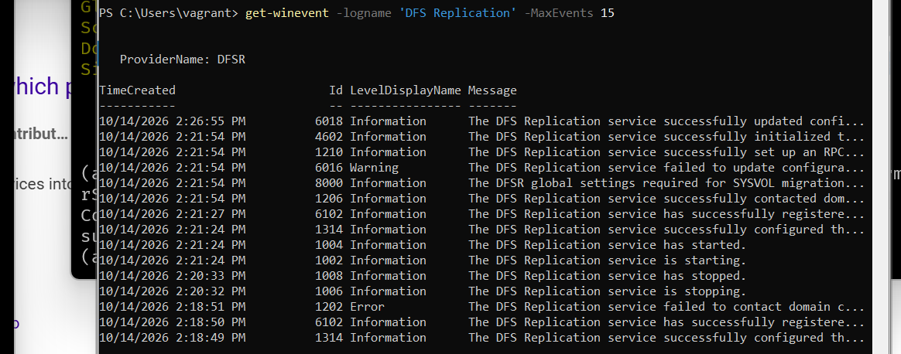

Otras capturas de este paso:

- Consola *Usuarios y equipos de Active Directory* en DC01, con el menú del dominio `lab.local`:

  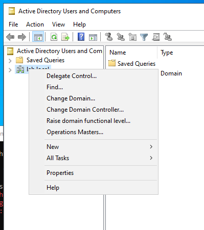

- *Administrador del servidor* en DC01 mostrando DC02 con *Kerberos target resolution error* (pendiente de revisar):

  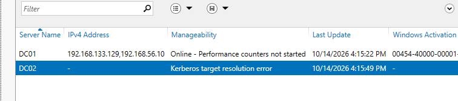

#### Problemas que me encontré

**1. `vagrant` no era Enterprise Admin.** Al promover DC01, las cuentas locales pasan al dominio: `LAB\vagrant` quedó en `BUILTIN\Administrators`, y el único miembro de *Enterprise Admins* era `Administrator`. Crear un dominio hijo modifica la partición de configuración del bosque, así que exige Enterprise Admins. Lo detecté antes de ejecutar nada, consultando los grupos:

```bash
ansible DC01 -m ansible.windows.win_shell -a '(Get-ADUser vagrant -Properties MemberOf).MemberOf; (Get-ADGroupMember "Enterprise Admins").SamAccountName'
```

Solución: el primer play del playbook 02 añade `vagrant` al grupo con `microsoft.ad.group`. En un entorno real sería una cuenta de servicio dedicada, y se quitaría del grupo al terminar.

**2. Registro glue con la IP NAT.** Después de la promoción, desde DC01 `dc02.emea.lab.local` resolvía también a `192.168.133.130`. Al crear la delegación, `Install-ADDSDomain` añade en la zona del padre un registro A (*glue*) por cada IP del DC hijo, y en ese momento su servidor DNS escuchaba en las dos NIC. La limpieza del rol se ejecuta en DC02, pero la zona `lab.local` solo existe en DC01 (`emea.lab.local` y `lab.local` son particiones de dominio distintas). Solución: la tarea 10, que se ejecuta en DC01 con `delegate_to: "{{ ad_parent_dc }}"`.

**3. `win_dns_client` devolvía `changed` en cada ejecución.** Al principio la tarea 2 usaba `ansible.windows.win_dns_client` con `adapter_names: "*"`. Tras la promoción, Windows añade `::1` como servidor DNS IPv6 en cada NIC, y el módulo reescribía la lista de todos los adaptadores, incluido el *Loopback Pseudo-Interface*, así que nunca coincidía:

```
Ethernet0    IPv4  {192.168.56.10, 192.168.56.11}
Ethernet0    IPv6  {::1}
Loopback...  IPv6  {fec0:0:0:ffff::1, fec0:0:0:ffff::2, fec0:0:0:ffff::3}
```

Solución: un `win_powershell` que solo compara y cambia los servidores **IPv4** de las NIC **activas**:

```powershell
param([string[]]$Servers)
$Ansible.Changed = $false
Get-NetAdapter | Where-Object Status -eq 'Up' | ForEach-Object {
  $current = @((Get-DnsClientServerAddress -InterfaceIndex $_.ifIndex -AddressFamily IPv4).ServerAddresses)
  if (($current -join ',') -ne ($Servers -join ',')) {
    Set-DnsClientServerAddress -InterfaceIndex $_.ifIndex -ServerAddresses $Servers
    $Ansible.Changed = $true
  }
}
```

**4. `'ad_parent_dc' is undefined` en DC01.** Después de añadir la tarea 10, el playbook 01 empezó a fallar en DC01, aunque la tarea tiene `when: "'dc_child' in group_names"`. Ansible resuelve `delegate_to` **antes** de evaluar el `when`, y en DC01 esa variable no existe. Solución:

```yaml
delegate_to: "{{ ad_parent_dc | default(inventory_hostname) }}"
```

Lo detecté porque, después de cada cambio en el rol, vuelvo a ejecutar **los dos** playbooks, no solo el que estoy tocando.

### Paso 8 — SRV01: servidor miembro unido al dominio

SRV01 (Windows Server 2022 Core) se une a `lab.local` como servidor miembro. No se une a cualquier sitio: su cuenta de equipo va en `OU=Servidores`, porque el contenedor por defecto `CN=Computers` no admite GPO. Los DC se quedan en `OU=Domain Controllers`, que tiene enlazada la *Default Domain Controllers Policy* y de la que no se mueven nunca.

**Inventario.** Un grupo nuevo dentro de `windows`, así que SRV01 hereda la conexión WinRM de `group_vars/windows/`:

```yaml
member_servers:
  hosts:
    SRV01:
      ansible_host: 192.168.56.20
```

**Variables** (`inventories/lab/group_vars/member_servers/vars.yml`):

```yaml
ad_dc_domain: "{{ ad_domain_name }}"
ad_parent_dc: DC01
ad_dns_servers:
  - "{{ hostvars[ad_parent_dc].ansible_host }}"     # 192.168.56.10
ad_member_ou: "OU=Servidores,{{ ad_domain_dn }}"     # OU=Servidores,DC=lab,DC=local
ad_join_user: "vagrant@{{ ad_domain_name }}"
ad_join_password: "{{ vault_windows_password }}"
```

`ad_domain_dn` se calcula en `group_vars/all/vars.yml` a partir de `ad_domain_name`: `lab.local` → `DC=lab,DC=local`.

**Dos roles, dos máquinas** (`playbooks/04-join-members.yml`):

| Play | Equipo | Rol | Qué hace |
|---|---|---|---|
| 1 | DC01 | `ad_ou` | Crea las OU de `ad_ous` y **preconfigura** la cuenta de equipo de SRV01 en `OU=Servidores` (*pre-staging*). Si ya existía en otro sitio, la mueve |
| 2 | SRV01 | `ad_member` | NIC NAT sin registro DNS → DNS de todas las NIC a DC01 → comprueba que el SRV `_ldap._tcp.dc._msdcs.lab.local` devuelve un DC → `microsoft.ad.membership` → `Test-ComputerSecureChannel` |

La comprobación del SRV antes de unir es intencionada: si el DNS está mal, el playbook se para con un error claro, en vez de fallar dentro del `Add-Computer` con un mensaje confuso.

**Por qué `microsoft.ad.membership` y no `Add-Computer` en un `win_powershell`:** el módulo describe un estado (`state: domain`) y no una acción. Si el equipo ya está unido devuelve `ok`, y gestiona él mismo el reinicio. Con `Add-Computer -Restart` habría que programar a mano la comprobación previa, y el reinicio cortaría la conexión de Ansible a mitad de tarea.

**Verificación** (en DC01):

```powershell
Get-ADComputer SRV01 | Select-Object DistinguishedName
# CN=SRV01,OU=Servidores,DC=lab,DC=local
```

La segunda ejecución del playbook termina con `changed=0` (captura con los nombres de tarea anteriores al renombrado):

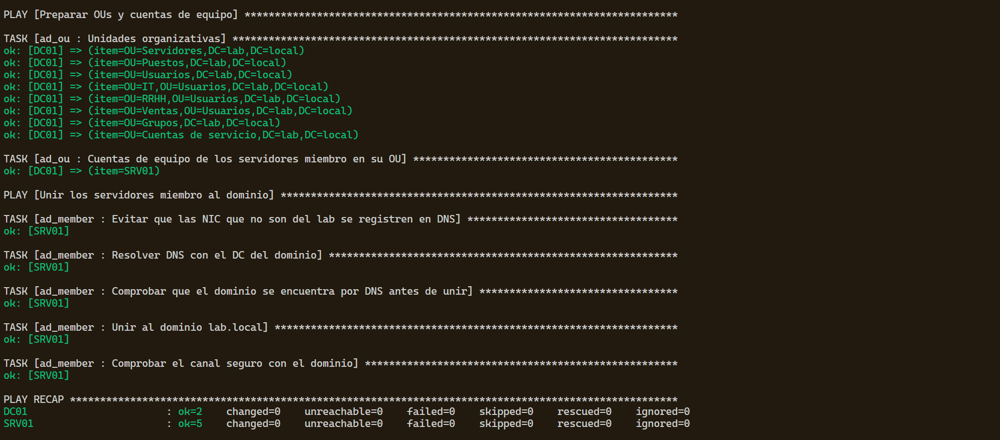

#### Problemas que me encontré

**1. SRV01 no encontraba el dominio.** `Resolve-DnsName lab.local` devolvía `DNS name does not exist`. La NIC del lab no tenía servidor DNS y la NIC NAT usaba `192.168.133.2`, el DNS de la NAT de VMware, que reenvía a Internet, donde `lab.local` no existe. Un equipo solo encuentra el dominio a través de su DNS: el rol pone DC01 como DNS en **todas** las NIC. Si una sigue con el DNS de la NAT, Windows puede usarla y fallar de forma intermitente.

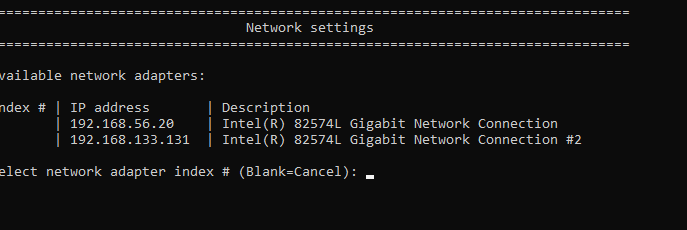

**2. `Add-Computer SRV01` no hace lo que parece.** Al probar la unión a mano, el primer parámetro posicional de `Add-Computer` es `-DomainName`, así que intentaba unir el equipo a un dominio llamado `SRV01`. La forma correcta: `Add-Computer -DomainName lab.local -OUPath 'OU=Servidores,DC=lab,DC=local' -Credential $cred -Restart`.

La unión a mano que hice, todavía sin `-OUPath`:

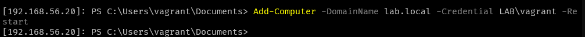

**3. `New-ADComputer failed: The specified account already exists`.** SRV01 ya estaba unido (a mano) en `CN=Computers`. Sin `identity`, `microsoft.ad.computer` busca el objeto por nombre **y ruta** (`CN=SRV01,OU=Servidores,…`), no lo encuentra e intenta crearlo. Solución: `identity: "SRV01$"` (el `sAMAccountName`, único en el dominio), que lo encuentra esté donde esté y lo mueve a la OU.

Así estaba antes del playbook, en el contenedor por defecto:

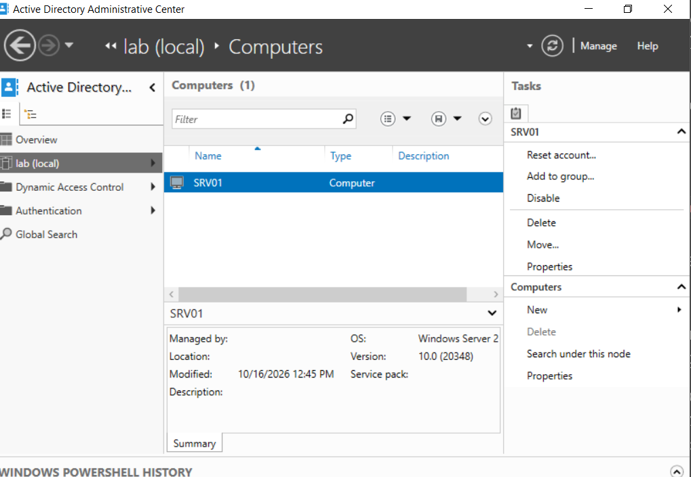

### Paso 9 — DNS como código

El DNS que dejó la promoción funcionaba, pero tenía carencias:

| Antes | Problema |
|---|---|
| Sin zona inversa | `192.168.56.10` no resolvía a nombre |
| Reenviadores de DC01: `fec0:0:0:ffff::1/2/3` y `192.168.133.2` | direcciones IPv6 *site-local* obsoletas y el DNS de la NAT de VMware |
| Sin aging ni scavenging | los registros dinámicos antiguos no se borran nunca |

**Variables** (separadas en ficheros `dns.yml` para no mezclarlas con las del dominio):

| Fichero | Variables |
|---|---|
| `group_vars/all/dns.yml` | `dns_reverse_zone` (calculada desde `ad_lab_network` → `56.168.192.in-addr.arpa`), `dns_aging_interval` (7 días), `dns_external_check`, `dns_records` |
| `group_vars/dc_root/dns.yml` | `dns_forwarders: [1.1.1.1, 9.9.9.9]`, `dns_aging_zones` (`lab.local` y la inversa) |
| `group_vars/dc_child/dns.yml` | `dns_forwarders`: la IP de DC01; `dns_aging_zones: [emea.lab.local]` |

**El rol `ad_dns`** (`playbooks/03-dns.yml`, en los dos DC):

| # | Tarea | Módulo | Raíz | Hijo |
|---|---|---|:-:|:-:|
| 1 | Configurar los reenviadores DNS del servidor | `win_powershell` | ✓ | ✓ |
| 2 | Crear la zona inversa replicada en todo el bosque | `ansible.windows.win_dns_zone` | ✓ | |
| 3 | Activar el aging en las zonas y el scavenging en el servidor | `win_powershell` | ✓ | ✓ |
| 4 | Crear los registros estáticos de `dns_records` en la zona del dominio | `ansible.windows.win_dns_record` | ✓ | ✓ |
| 5 | Forzar el registro dinámico del PTR propio si todavía no existe | `win_powershell` | ✓ | ✓ |
| 6 | Comprobar la resolución: registros estáticos, PTR propio y un nombre de Internet | `win_powershell` + `until` | ✓ | ✓ |

Decisiones:

- **Zona inversa con replicación de bosque**, no de dominio: DC02 está en otro dominio y tiene que poder registrar su PTR en ella.
- **Los PTR de los DC no se escriben en el código**: los crea el registro dinámico (`Register-DnsClient`). El código solo lo fuerza si falta.
- **DC02 reenvía a DC01**: la consulta de un cliente de `emea` a Internet sigue la cadena cliente → DC02 → DC01 → 1.1.1.1.
- **La tarea 6 reintenta** (`retries: 12`, `delay: 10`): el PTR de DC02 tardó unos 40 segundos en registrarse y replicarse.

**Resultado** (salida completa en `docs/evidencias/paso9-dns.txt`):

```
DC01: PTR 192.168.56.10: true, intranet.lab.local: true, wiki.lab.local: true, portal.emea.lab.local: true, microsoft.com: true
DC02: PTR 192.168.56.11: true, intranet.lab.local: true, wiki.lab.local: true, portal.emea.lab.local: true, microsoft.com: true
```

`portal.emea.lab.local` es un CNAME de la zona hija que apunta a `intranet.lab.local`, de la zona padre: comprueba la resolución en los dos sentidos (delegación y reenviador).

#### Problemas que me encontré

**`community.windows.win_dns_zone has been deprecated`.** Los módulos de DNS se han movido a `ansible.windows`. Mismo nombre y mismos parámetros: solo cambia el prefijo, y el lab deja de depender de `community.windows`.

### Paso 10 — OU, grupos, usuarios de prueba y papelera de reciclaje

Datos de prueba sobre los que practicar la operación de AD.

**Estructura de OU** (`ad_ous` en `group_vars/all/vars.yml`; la OU padre va antes que sus hijas):

```
DC=lab,DC=local
├── Domain Controllers      (de AD)
├── Servidores
├── Puestos
├── Usuarios
│   ├── IT
│   ├── RRHH
│   └── Ventas
├── Grupos
└── Cuentas de servicio
```

**Datos en `data/`**, separados del código:

- `data/grupos.yml`: `GG_IT`, `GG_RRHH`, `GG_Ventas` (grupos globales de seguridad, en `OU=Grupos`).
- `data/usuarios.yml`: 6 usuarios; la OU sale del departamento (`OU=<departamento>,OU=Usuarios,…`).

**El rol `ad_users_groups`** (`playbooks/05-identidades.yml`, en DC01) crea grupos y usuarios con `microsoft.ad.group` y `microsoft.ad.user`. Dos decisiones para que el rol solo fije el **estado inicial**:

- `update_password: on_create`: la contraseña se pone al crear el usuario y no se vuelve a tocar.
- Sin `enabled`: el módulo habilita la cuenta al crearla y después no gestiona ese atributo.

Así, si un usuario se deshabilita o cambia de contraseña después, volver a lanzar el playbook no lo deshace.

**Contraseña inicial** en el vault: `vault_ad_test_user_password`, en `group_vars/domain_controllers/vault.yml`. La necesita quien crea los usuarios (un DC), no los usuarios. La tarea lleva `no_log: true` para que la contraseña no aparezca en la salida si algo falla.

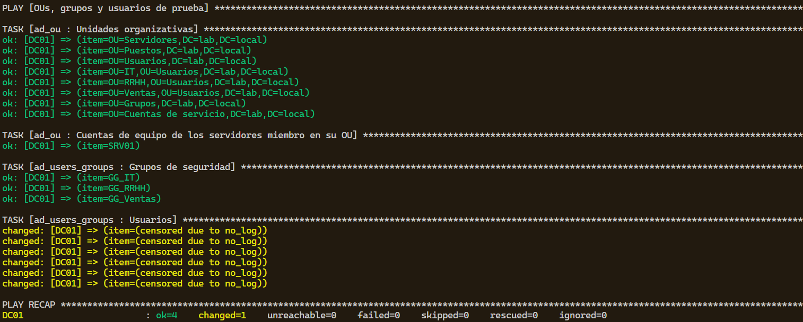

**Papelera de reciclaje de AD** (última tarea de `roles/ad_forest/tasks/main.yml`). Se activa una vez para todo el bosque y **no se puede desactivar**. No hay módulo para esto, así que es un `win_powershell` con su comprobación:

```powershell
$feature = Get-ADOptionalFeature -Identity 'Recycle Bin Feature'
if ($feature.EnabledScopes.Count -gt 0) { $Ansible.Changed = $false; return }
Enable-ADOptionalFeature -Identity $feature -Scope ForestOrConfigurationSet -Target 'lab.local' -Confirm:$false
```

A mano, `Enable-ADOptionalFeature` pide confirmación porque es irreversible; por eso la tarea lleva `-Confirm:$false`. Después, `EnabledScopes` ya no está vacío:

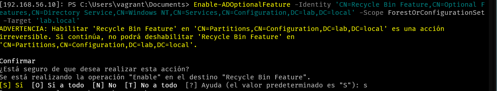

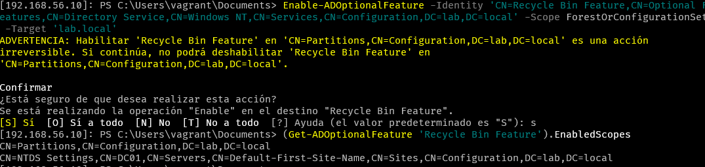

**Verificación** (en DC01):

```
DistinguishedName                                        Enabled GivenName
CN=Ana García,OU=IT,OU=Usuarios,DC=lab,DC=local             True Ana
CN=Luis Martín,OU=IT,OU=Usuarios,DC=lab,DC=local            True Luis
CN=Marta López,OU=RRHH,OU=Usuarios,DC=lab,DC=local          True Marta
CN=Pedro Sanz,OU=Ventas,OU=Usuarios,DC=lab,DC=local         True Pedro
CN=Elena Ruiz,OU=Ventas,OU=Usuarios,DC=lab,DC=local         True Elena
CN=Temporal Borrar,OU=Ventas,OU=Usuarios,DC=lab,DC=local    True Temporal
```

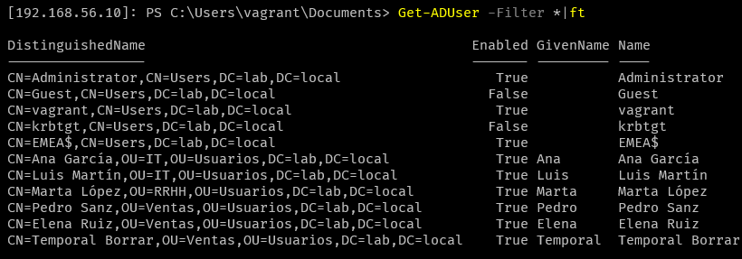

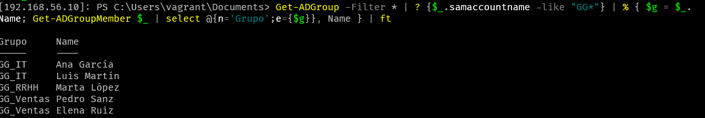

#### Problemas que me encontré

**1. `'vault_ad_test_user_password' is undefined`, y después `Vault format unhexlify error`.** Añadí la variable editando `vault.yml` con `nano` directamente, no con `ansible-vault edit`. La línea quedó **en claro**, pegada debajo del bloque cifrado, y Ansible no podía descifrar el fichero. Se arregló recuperando la versión de git y editando de la forma correcta:

```bash
git checkout -- inventories/lab/group_vars/domain_controllers/vault.yml
EDITOR=nano ansible-vault edit inventories/lab/group_vars/domain_controllers/vault.yml
```

Para comprobar que un vault está cifrado entero, sin mostrar secretos: la primera línea es `$ANSIBLE_VAULT;1.1;AES256` y el resto solo hexadecimal (`tail -n +2 vault.yml | grep -cvE '^[0-9a-f]+$'` debe dar `0`). Para comprobar que una variable existe sin mostrarla: `ansible DC01 -m debug -a "msg={{ vault_ad_test_user_password is defined }}"`.

**2. El playbook 01 reinició DC01 sin cambiar nada.** La tarea de instalar AD DS salió `ok` (ya estaba instalado), pero Windows tenía un reinicio pendiente por otro motivo, y la tarea de reinicio solo miraba `reboot_required`. Un playbook que no cambia nada no puede reiniciar un DC: ahora el reinicio exige las dos condiciones:

```yaml
when: adds_feature is changed and adds_feature.reboot_required
```

La ejecución que lo destapó: todo `ok` salvo el reinicio.

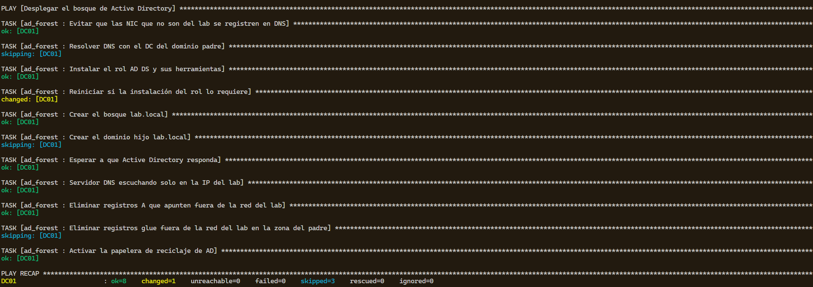

### Paso 11 — Recrear el lab desde cero

Todo lo anterior se puede montar con dos comandos. Los pasos 1 a 10 explican cómo y por qué; esta sección es la receta.

**1. Una sola vez en el equipo** (no está en código porque es configuración del host):

| Qué | Dónde se explica |
|---|---|
| VMware Workstation, Vagrant, plugin y Vagrant VMware Utility (con el arreglo del registro) | Paso 1 |
| Red **VMnet1** host-only `192.168.56.0/24` sin DHCP, y el equipo con `192.168.56.1` | Paso 3 |
| WSL con el entorno de Ansible y `/etc/wsl.conf` con `metadata` | Pasos 4 y 5 |
| La **clave del vault** en `~/.ansible/lab-vault-pass` (permisos `600`) | Paso 5 y abajo |
| `TrustedHosts` para conectarse por PowerShell a las VMs | [Acceso a las VMs](#acceso-a-las-vms) |

> **La clave del vault es lo único que no se puede recuperar.** Está fuera del repo a propósito. Guardo una copia en mi gestor de contraseñas: sin ella, los `vault.yml` no se pueden descifrar y habría que crearlos de nuevo.

**2. Las VMs** (PowerShell, en la raíz del repo):

```powershell
vagrant up --provider vmware_desktop
```

**3. Todo el AD** (WSL):

```bash
source ~/.venvs/ansible/bin/activate
cd /mnt/c/Users/vramo/ad-gpo-automation
ansible-galaxy collection install -r collections/requirements.yml
ansible-playbook playbooks/site.yml
```

`playbooks/site.yml` importa los playbooks del 01 al 05 en orden. Sobre un lab ya montado, termina con `changed=0`.

**Todo de una vez** (PowerShell, en la raíz del repo): `scripts/Rebuild-Lab.ps1` hace los pasos 2 y 3 seguidos y comprueba la idempotencia. Pide escribir `SI` antes de borrar las VMs.

```powershell
.\scripts\Rebuild-Lab.ps1                # borra las VMs, las recrea y aplica site.yml dos veces
.\scripts\Rebuild-Lab.ps1 -SinDestruir   # solo site.yml dos veces (para relanzar si falla un playbook)
```

| Fase | Qué hace |
|---|---|
| 1 | `vagrant destroy -f` y `vagrant up --provider vmware_desktop` |
| 2 | espera a que las tres VMs respondan por WinRM en su IP del lab (`192.168.56.10`, `.11`, `.20`) |
| 3 | `playbooks/site.yml` en WSL; salida en `docs/evidencias/paso11-site-1-despliegue.txt` |
| 4 | `playbooks/site.yml` otra vez; salida en `docs/evidencias/paso11-site-2-idempotencia.txt`. Avisa si algún host tiene `changed` distinto de 0 |

#### Problemas que me encontré

**`vagrant up DC01` se quedaba en *Waiting for machine to boot*.** Al arrancar, Vagrant pregunta a VMware (`vmrun`) la IP de la VM para reenviarle los puertos (WinRM, RDP). VMware le devolvió la IP del lab, `192.168.56.10`, y no la de la NAT. La tabla de reenvíos de la NAT (`C:\ProgramData\VMware\vmnetnat.conf`) quedó así:

```
2229 = 192.168.56.10:5985     ← la NAT (VMnet8) no llega a VMnet1
2217 = 192.168.133.130:5985   ← DC02: correcto
```

Vagrant esperaba WinRM en `127.0.0.1:2229` y nunca llegaba. Solución en el `Vagrantfile`, en cada VM: `vm.enable_vmrun_ip_lookup = false`, para que la IP se saque del DHCP de la NAT, que siempre es la correcta. Se aplica con `vagrant reload`.

### Cuentas y contraseñas del lab

Todas las contraseñas están en el vault; los `vars.yml` solo las referencian. Para verlas: `ansible-vault view <fichero>` (nunca `decrypt`, que deja el fichero descifrado en el disco).

| Variable (vault) | Fichero | Cuenta | Para qué |
|---|---|---|---|
| `vault_windows_password` | `group_vars/windows/vault.yml` | `vagrant` (local; tras crear el bosque `LAB\vagrant`, Domain Admins y Enterprise Admins) | conexión WinRM de Ansible (`ansible_password`), crear el dominio hijo (`ad_enterprise_admin_password`) y unir SRV01 (`ad_join_password`) |
| `vault_ad_dsrm_password` | `group_vars/domain_controllers/vault.yml` | `Administrator` local de cada DC en modo DSRM | arrancar un DC sin AD para recuperarlo; no es una cuenta del dominio |
| `vault_ad_test_user_password` | `group_vars/domain_controllers/vault.yml` | usuarios de prueba de `data/usuarios.yml` | contraseña inicial al crearlos (`playbooks/05-identidades.yml`) |
| `vault_svc_join_password` | `group_vars/windows/vault.yml` | `svc_join` (**pendiente de crear**) | unir equipos al dominio con permiso solo sobre `OU=Servidores`, en lugar de `vagrant` |
| `vault_svc_ansible_password` | `group_vars/windows/vault.yml` | `svc_ansible` (**pendiente de crear**) | conexión de Ansible y de Semaphore (ad-ops-portal) con los permisos justos, en lugar de `vagrant` |

### Acceso a las VMs

Ansible entra por la IP del lab. Para trabajar a mano hago lo mismo, en vez de usar los puertos reenviados por Vagrant.

**Escritorio remoto** (DC01, que tiene escritorio): `mstsc /v:192.168.56.10`, usuario `LAB\vagrant`.

**PowerShell remoto.** Por IP, Windows exige que el destino esté en `TrustedHosts`. Una sola vez, en PowerShell como administrador:

```powershell
Start-Service WinRM
Set-Item WSMan:\localhost\Client\TrustedHosts -Value "192.168.56.10,192.168.56.11,192.168.56.20" -Force
```

Después, sin administrador:

```powershell
Enter-PSSession 192.168.56.10 -Credential (Get-Credential LAB\vagrant)     # DC01
Enter-PSSession 192.168.56.11 -Credential (Get-Credential EMEA\vagrant)    # DC02
Enter-PSSession 192.168.56.20 -Credential (Get-Credential LAB\vagrant)     # SRV01
```

**`vagrant powershell <VM>` no funciona** (*Unable to establish a remote PowerShell connection*). Es un fallo de Vagrant 2.4.9: su script `plugins/commands/powershell/scripts/enable_psremoting.ps1` construye el usuario como `"$hostname\\$username"`, y en PowerShell `\\` son dos barras literales: envía `127.0.0.1\\vagrant` y el invitado responde *Acceso denegado*. Con `-c` sí funciona (`vagrant powershell DC01 -c "hostname"`), porque usa el cliente WinRM de Vagrant.

## Estructura del proyecto

```
ad-gpo-automation/
├── Vagrantfile                     # DC01, DC02 y SRV01 en VMware
├── ansible.cfg
├── collections/requirements.yml    # colecciones con versión fija
├── inventories/lab/
│   ├── hosts.yml                   # dc_root, dc_child, member_servers
│   └── group_vars/                 # all, windows, domain_controllers, dc_root, dc_child, member_servers
│                                   # (vars.yml en claro, vault.yml cifrado, dns.yml)
├── data/                           # grupos.yml, usuarios.yml (datos de prueba)
├── playbooks/
│   ├── site.yml                    # monta todo: importa 01 a 05
│   ├── 00-estado-dc.yml            # solo lectura: estado de los DC
│   ├── 01-deploy-forest.yml        # bosque lab.local y papelera
│   ├── 02-deploy-child-domain.yml  # dominio hijo emea.lab.local
│   ├── 03-dns.yml                  # DNS de los DC
│   ├── 04-join-members.yml         # OU y unión de servidores miembro
│   └── 05-identidades.yml          # grupos y usuarios de prueba
├── roles/
│   ├── ad_forest/                  # promoción de DCs, limpieza DNS, papelera
│   ├── ad_dns/                     # reenviadores, zona inversa, aging, registros, pruebas
│   ├── ad_ou/                      # OU y cuentas de equipo preconfiguradas
│   ├── ad_member/                  # unión de un servidor al dominio
│   └── ad_users_groups/            # grupos y usuarios desde data/
├── scripts/                        # Set-LabIP.ps1, Optimize-LabGuest.ps1, Test-LabTools.ps1
└── docs/                           # evidencias de ejecución e imágenes
```
