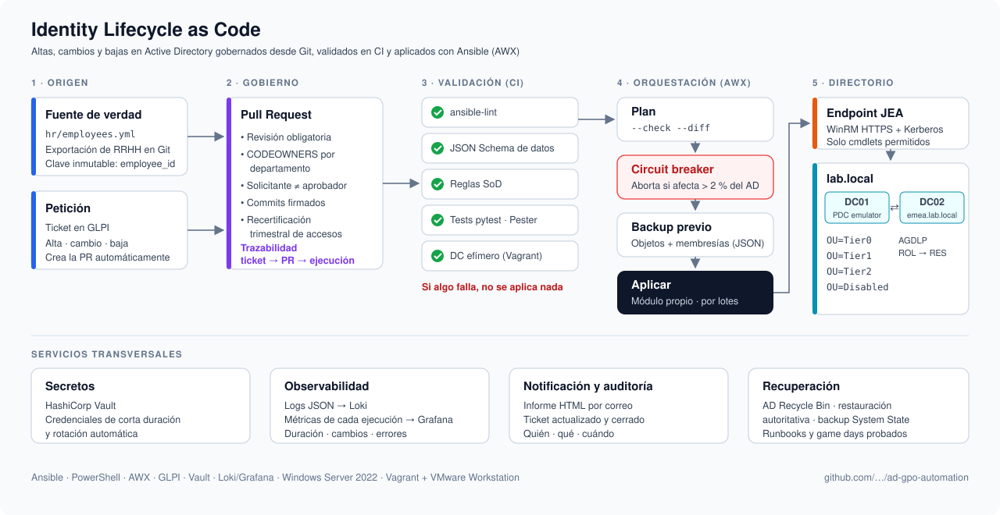
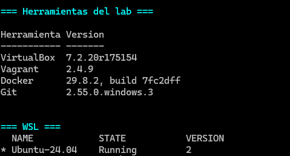

# ad-gpo-automation

Laboratorio para automatizar Active Directory y GPOs con Ansible (`microsoft.ad`, `ansible.windows`) y PowerShell.
Aquí voy contando paso a paso cómo he montado todo.

## Arquitectura objetivo



El objetivo no es un alta masiva desde CSV, sino gestionar el **ciclo de vida completo de las identidades** (altas, cambios y bajas) como código:

- **Fuente de verdad en Git:** los cambios entran por Pull Request revisada por el responsable del área (CODEOWNERS), con separación entre quien solicita y quien aprueba.
- **Validación en CI antes de tocar el AD:** esquema de datos, reglas de segregación de funciones (SoD), `ansible-lint` y tests contra un DC efímero.
- **Ejecución segura:** plan con `--check --diff`, *circuit breaker* que aborta si un cambio afecta a demasiados objetos, backup previo y aplicación por lotes a través de un endpoint JEA con mínimo privilegio.
- **Operación:** secretos en Vault, logs y métricas en Grafana, informe por correo, cierre del ticket y procedimientos de recuperación probados.


## Hoja de ruta

**Montaje del entorno** (sección [Cómo he montado el entorno](#cómo-he-montado-el-entorno))

- [x] Paso 1 — Herramientas en el host
- [x] Paso 2 — Repositorio Git y estructura del proyecto
- [x] Paso 3 — Primera VM: DC01 con Vagrant
- [x] Paso 4 — Nodo de control Ansible en WSL y primer `win_ping`
- [x] Paso 5 — Inventario y credenciales cifradas con Ansible Vault
- [x] Paso 6 — Promoción de DC01 a controlador de dominio (`lab.local`) con Ansible
- [x] Cambio de VirtualBox a VMware Workstation
- [ ] Paso 7 — DC02 (dominio hijo) y SRV01 (servidor miembro)
  - [x] DC02: dominio hijo `emea.lab.local`
  - [ ] SRV01: servidor miembro

**Fases de automatización** (cuando el entorno esté listo)

- [ ] Fase 1 — Identity Lifecycle as Code: altas, cambios y bajas
- [ ] Fase 2 — GPO como código, backup y rollback
- [ ] Fase 3 — AWX como orquestador
- [ ] Fase 4 — Parcheo orquestado por oleadas
- [ ] Fase 5 — Monitorización y Event-Driven Ansible (*self-healing*)
- [ ] Fase 6 — Ticketing (GLPI) y notificaciones por correo

## Cómo he montado el entorno

### Paso 1 — Herramientas en el host

**Mi equipo:** Windows 11 Home, i7-13700HX, 32 GB de RAM, con WSL2 (Ubuntu 24.04) ya funcionando.

Windows 11 Home no trae Hyper-V Manager, así que las VMs del lab las monto con **VirtualBox** y las defino con **Vagrant**, para poder recrearlas cuando quiera. Además he instalado **Docker Desktop** (usa WSL2 como backend) y **Git**.

> **Actualización:** después del Paso 6 cambié VirtualBox por **VMware Workstation Pro**, porque con el hipervisor de Windows activo VirtualBox era demasiado lento. Los pasos 1 a 6 cuentan el montaje original con VirtualBox; el motivo y los cambios están en [Cambio de VirtualBox a VMware Workstation](#cambio-de-virtualbox-a-vmware-workstation).

Instalé todo con `winget` desde una PowerShell como administrador:

```powershell
winget install -e --id Oracle.VirtualBox --accept-package-agreements --accept-source-agreements
winget install -e --id Hashicorp.Vagrant
winget install -e --id Docker.DockerDesktop
winget install -e --id Git.Git
```

Versiones instaladas (octubre 2026):

| Herramienta | Versión |
|---|---|
| VirtualBox | 7.2.20 (winget instaló también la dependencia Microsoft.VCRedist.2015+.x64) |
| Vagrant | 2.4.9 |
| Docker Desktop | 4.94.0 (Docker Engine 29.8.2) |
| Git | 2.55.0.windows.3 |
| WSL | Ubuntu-24.04, versión 2 |

Como ya tenía WSL2, Hyper-V está activo. Para que VirtualBox funcione encima de él, activé Windows Hypervisor Platform:

```powershell
dism /online /enable-feature /featurename:HypervisorPlatform /all /norestart
dism /online /enable-feature /featurename:VirtualMachinePlatform /all /norestart
```

Las dos órdenes terminaron con *"La operación se completó correctamente"*. Después **reinicié** el equipo (con `/norestart` no se aplican hasta reiniciar).

Lo comprobé también de forma gráfica: **Windows + R → `optionalfeatures`**. En la lista aparecen marcadas:

- [x] Plataforma de máquina virtual
- [x] Plataforma del hipervisor de Windows

O desde PowerShell como administrador:

```powershell
Get-WindowsOptionalFeature -Online |
  Where-Object FeatureName -in 'HypervisorPlatform','VirtualMachinePlatform' |
  Select-Object FeatureName, State
```

Las dos deben salir en estado `Enabled`.

Para comprobar que todo estaba bien instalado, preparé un script que muestra todas las versiones de una vez ([`scripts/Test-LabTools.ps1`](scripts/Test-LabTools.ps1)):

```powershell
powershell -ExecutionPolicy Bypass -File .\scripts\Test-LabTools.ps1
```



También se puede comprobar herramienta por herramienta:

```powershell
& "C:\Program Files\Oracle\VirtualBox\VBoxManage.exe" --version
vagrant --version
docker --version
git --version
wsl -l -v
```

Notas de este paso:

- **Docker Desktop:** lo abrí una vez para aceptar la licencia y activé *Settings → Resources → WSL Integration → Ubuntu-24.04*.
- **VirtualBox con Hyper-V:** funciona, pero algo más lento. Sale una tortuga verde en la barra de estado de las VMs; es normal.
- **Si falla la instalación de VirtualBox por Visual C++:** `winget install -e --id Microsoft.VCRedist.2015+.x64` y volver a instalar.
- **Si no se reconoce `vagrant` o `docker`:** me pasó con `docker` ("El término 'docker' no se reconoce..."). Docker estaba bien instalado y su ruta (`C:\Program Files\Docker\Docker\resources\bin`) ya estaba en el PATH del sistema, pero la terminal se había abierto antes de la instalación. Se arregla cerrando y abriendo la terminal, o recargando el PATH en la misma sesión:

  ```powershell
  $env:Path = [Environment]::GetEnvironmentVariable('Path','Machine') + ';' + [Environment]::GetEnvironmentVariable('Path','User')
  ```

### Paso 2 — Repositorio Git y estructura del proyecto

Creé las carpetas del proyecto (vacías por ahora, con un `.gitkeep` para que Git las guarde) e inicialicé el repositorio:

```powershell
git init -b main
git add -A
git commit -m "Paso 1 y 2: herramientas del host y estructura del proyecto"
```

Añadí dos ficheros de configuración:

- **`.gitignore`:** deja fuera la carpeta `.vagrant/` de las VMs, las contraseñas del vault de Ansible (`.vault_pass*`) y el entorno virtual de Python (`.venv/`). **Las credenciales nunca se suben al repo.**
- **`.gitattributes`:** los ficheros de Ansible (YAML) usan finales de línea LF, porque Ansible se ejecuta desde WSL (Linux), y los scripts de PowerShell usan CRLF.

### Paso 3 — Primera VM: DC01 con Vagrant

**Imagen base.** Vagrant no instala Windows desde una ISO: usa una *box*, una VM ya instalada y preparada. Uso la de Windows Server 2022 Standard (evaluación) de `gusztavvargadr`, que trae WinRM habilitado y el usuario `vagrant`/`vagrant`:

```powershell
vagrant box add gusztavvargadr/windows-server-2022-standard --provider virtualbox
vagrant box list
```

**Vagrantfile.** Define la VM DC01 con IP fija en una red privada del lab:

```ruby
Vagrant.configure("2") do |config|
  config.vm.box          = "gusztavvargadr/windows-server-2022-standard"
  config.vm.box_version  = "2607.0.0"        # versión fija: lab reproducible
  config.vm.communicator = "winrm"
  config.winrm.transport = :negotiate        # NTLM: sigue funcionando tras promover a DC
  config.vm.boot_timeout = 900
  config.vm.synced_folder ".", "/vagrant", disabled: true

  config.vm.define "DC01" do |dc|
    dc.vm.hostname = "DC01"
    dc.vm.network "private_network", ip: "192.168.56.10"
    dc.vm.provider "virtualbox" do |vb|
      vb.name         = "lab-DC01"
      vb.memory       = 4096
      vb.cpus         = 1                    # ver problema 2
      vb.gui          = true
      vb.linked_clone = true
    end
  end
end
```

Decisiones:

- **`transport = :negotiate`:** la autenticación *basic* solo funciona con cuentas locales. Al promover la VM a controlador de dominio desaparecen las cuentas locales y Vagrant dejaría de poder conectarse.
- **`private_network`:** además de la NIC NAT que crea Vagrant (salida a Internet), una segunda NIC *host-only* con IP fija `192.168.56.10`. Esa es la red del lab, por la que entrará Ansible.
- **`linked_clone`:** la box se importa una sola vez como VM maestra y cada VM usa un disco diferencial. Ahorra disco y tiempo al crear DC02 y SRV01.

Para crearla:

```powershell
vagrant validate
vagrant up DC01
```

#### Problemas que me encontré

**1. Errores de sintaxis en el Vagrantfile.** `vagrant validate` los detecta antes de crear nada:

- `syntax error, unexpected ':'` → había un punto en lugar de una coma: `"/vagrant". disabled:` en vez de `"/vagrant", disabled:`.
- `The following settings shouldn't exist: boot, synced, version, linked` → había escrito `boot.timeout` en lugar de `boot_timeout` (y lo mismo con `synced_folder`, `box_version` y `linked_clone`). Para Vagrant el punto separa niveles de configuración; el guion bajo forma parte del nombre.

**2. La VM se quedaba en negro y `vagrant up` acababa con `Timed out while waiting for the machine to boot`.**

La ventana de la VM no mostraba nada, ni siquiera el logo. El log de VirtualBox (`%USERPROFILE%\VirtualBox VMs\lab-DC01\Logs\VBox.log`) mostraba la causa:

```
HM: HMR3Init: Attempting fall back to NEM: VT-x is not available
...
EFI: debug point DXE_AP
EFI: VBoxDbg> loadimage64 'PciHostBridgeDxe.efi' ...
```

- Como Hyper-V está activo (por WSL2 y Docker), VirtualBox no puede usar VT-x directamente y funciona **a través de Hyper-V (NEM)**: es la tortuga verde de la barra de estado.
- El firmware UEFI de la VM se colgaba al inicializar la **segunda CPU virtual** (`DXE_AP`) y no pasaba de `PciHostBridgeDxe.efi`, aunque la VM estuviera horas encendida.

**Solución:** `vb.cpus = 1`. Con una sola vCPU el firmware arranca, Windows carga en menos de un minuto y Vagrant conecta por WinRM:

```powershell
vagrant halt DC01 --force   # apagado forzado: Windows ni había arrancado
vagrant up DC01
```

### Paso 4 — Nodo de control Ansible en WSL y primer contacto con DC01

Ansible no funciona de forma nativa en Windows, así que el nodo de control es mi Ubuntu 24.04 de WSL. Desde WSL el repo está en `/mnt/c/Users/vramo/ad-gpo-automation`.

**Comprobación de red.** Antes de instalar nada, verifiqué que WinRM de DC01 responde por la red del lab, primero desde Windows y luego desde WSL:

```powershell
Test-NetConnection 192.168.56.10 -Port 5985   # TcpTestSucceeded : True
```

```bash
nc -zv 192.168.56.10 5985
```

**Instalación en un entorno virtual de Python.** Así Ansible no se mezcla con los paquetes del sistema (Ubuntu 24.04 ya bloquea `pip install` en el Python del sistema):

```bash
sudo apt update && sudo apt install -y python3-venv python3-pip
python3 -m venv ~/.venvs/ansible
source ~/.venvs/ansible/bin/activate          # el prompt muestra (ansible)
pip install ansible pywinrm
ansible-galaxy collection install ansible.windows microsoft.ad community.windows
```

Cada vez que abro una terminal nueva activo el entorno con `source ~/.venvs/ansible/bin/activate` (y `deactivate` para salir).

**Primer `win_ping`.** Una prueba ad-hoc, todavía sin inventario, pasando la conexión como variables:

```bash
ansible all -i '192.168.56.10,' -m ansible.windows.win_ping \
  -e ansible_connection=winrm \
  -e ansible_port=5985 \
  -e ansible_winrm_transport=ntlm \
  -e ansible_winrm_server_cert_validation=ignore \
  -e ansible_user=vagrant \
  -e ansible_password=vagrant
```

```
192.168.56.10 | SUCCESS => {
    "changed": false,
    "ping": "pong"
}
```

La cadena completa funciona: WSL → red host-only de VirtualBox → WinRM → Windows Server. La coma de `-i '192.168.56.10,'` es necesaria: le dice a Ansible que es una lista de hosts y no la ruta a un fichero de inventario.

> Pasar la contraseña por la línea de comandos solo vale para esta prueba: queda en el historial de la shell. En el siguiente paso la conexión pasa a un inventario y la contraseña a Ansible Vault.

### Paso 5 — Inventario y credenciales cifradas con Ansible Vault

Pasar IP, usuario y contraseña en cada comando es incómodo, no escala y deja la contraseña en el historial de la shell. Lo sustituí por la estructura estándar de Ansible:

```
ansible.cfg                                 # valores por defecto del proyecto
inventories/lab/
├── hosts.yml                               # QUÉ máquinas hay y en qué grupos
└── group_vars/windows/
    ├── vars.yml                            # CÓMO conectarse (en claro)
    └── vault.yml                           # la contraseña (cifrada, AES-256)
```

**Inventario** (`inventories/lab/hosts.yml`):

```yaml
all:
  children:
    windows:
      children:
        domain_controllers:
          hosts:
            DC01:
              ansible_host: 192.168.56.10
```

DC01 está en `domain_controllers`, que está dentro de `windows`. Los grupos se heredan, así que DC01 recibe las variables de `group_vars/windows/`, y cualquier servidor que añada después al grupo `windows` también.

**Variables de conexión** (`inventories/lab/group_vars/windows/vars.yml`):

```yaml
ansible_connection: winrm
ansible_port: 5985
ansible_winrm_transport: ntlm
ansible_winrm_server_cert_validation: ignore
ansible_user: vagrant
ansible_password: "{{ vault_windows_password }}"
```

`ansible_password` no contiene la contraseña: es una referencia a una variable definida en el vault. Separar `vars.yml` (en claro) y `vault.yml` (cifrado) permite ver qué variables existen sin descifrar nada, y el prefijo `vault_` indica de dónde viene cada una.

**Vault.** La clave que descifra el vault se genera aleatoriamente y vive **fuera del repo**, en mi home de Linux, con permisos solo para mi usuario:

```bash
mkdir -p ~/.ansible
openssl rand -base64 32 > ~/.ansible/lab-vault-pass
chmod 600 ~/.ansible/lab-vault-pass

ansible-vault create --vault-password-file ~/.ansible/lab-vault-pass \
  inventories/lab/group_vars/windows/vault.yml
# contenido: vault_windows_password: <contraseña>
```

En el repo solo queda el fichero cifrado, que empieza por `$ANSIBLE_VAULT;1.1;AES256`. Para consultarlo o cambiarlo: `ansible-vault view` / `ansible-vault edit`.

**Configuración del proyecto** (`ansible.cfg`, en la raíz del repo):

```ini
[defaults]
inventory = inventories/lab/hosts.yml
vault_password_file = ~/.ansible/lab-vault-pass
host_key_checking = False
retry_files_enabled = False
interpreter_python = auto_silent
```

**Resultado.** El mismo `win_ping` del paso anterior, ahora sin IP, usuario ni contraseña en la línea de comandos:

```bash
ansible --version | grep "config file"     # config file = .../ad-gpo-automation/ansible.cfg
ansible windows -m ansible.windows.win_ping
```

```
DC01 | SUCCESS => {
    "changed": false,
    "ping": "pong"
}
```

#### Problemas que me encontré

**Ansible ignora el `ansible.cfg` en `/mnt/c`.** Por defecto WSL monta las unidades de Windows con permisos 777, y Ansible no lee un `ansible.cfg` en una carpeta en la que cualquiera puede escribir (sería una vía para inyectar configuración). Se corrige en `/etc/wsl.conf`, y después `wsl --shutdown` desde PowerShell:

```ini
[automount]
options = "metadata,umask=22,fmask=11"
```

**`No inventory was parsed ... Could not match supplied host pattern: windows`.** Ansible no encontraba el inventario porque el `ansible.cfg` aún no existía. `ansible --version | grep "config file"` muestra qué fichero de configuración está usando (o `None`).

### Paso 6 — DC01 promovido a controlador de dominio de `lab.local` con Ansible

Primera automatización real: un rol de Ansible (`ad_forest`) que convierte un Windows Server recién creado en el primer controlador de dominio de un bosque nuevo. Es idempotente: si el dominio ya existe, no cambia nada.

**Datos del dominio** (`inventories/lab/group_vars/all/vars.yml`), comunes a todas las máquinas porque los servidores miembro los necesitarán para unirse:

```yaml
ad_domain_name: lab.local
ad_netbios_name: LAB
ad_forest_mode: WinThreshold      # nivel funcional Windows Server 2016
ad_domain_mode: WinThreshold
ad_lab_network: 192.168.56.0/24
```

**Contraseña DSRM** (*Directory Services Restore Mode*, la cuenta de emergencia del DC para restaurar AD cuando el servicio está parado). Está en `group_vars/domain_controllers/`, y no en `all/`, por mínimo privilegio: solo los DCs reciben ese secreto.

```
group_vars/domain_controllers/vars.yml   → ad_dsrm_password: "{{ vault_ad_dsrm_password }}"
group_vars/domain_controllers/vault.yml  → vault_ad_dsrm_password (cifrado)
```

**El rol** (`roles/ad_forest/tasks/main.yml`):

| # | Tarea | Módulo | Por qué |
|---|---|---|---|
| 1 | Las NIC que no son del lab no se registran en DNS | `win_powershell` | La VM tiene dos NIC: NAT (`10.0.2.15`, la de Vagrant) y la del lab. Si el DC registra la IP NAT, los clientes intentan contactar con una IP inalcanzable |
| 2 | Instalar el rol AD DS | `win_feature` | Requisito previo de la promoción |
| 3 | Reiniciar solo si hace falta | `win_reboot` + `when` | |
| 4 | Crear el bosque | `microsoft.ad.domain` | Equivale a `Install-ADDSForest`: crea `lab.local`, instala DNS y reinicia. `reboot_timeout: 1800` (ver problemas) |
| 5 | Esperar a que AD responda | `win_powershell` + `until`/`retries` | Tras el reinicio AD tarda en estar disponible |
| 6 | Servidor DNS escuchando solo en la IP del lab | `win_powershell` | Ver problemas |
| 7 | Eliminar registros A fuera de la red del lab | `win_powershell` | Limpia `lab.local` y `_msdcs.lab.local` |

**El playbook** (`playbooks/01-deploy-forest.yml`) solo dice a quién se aplica:

```yaml
- name: Desplegar el bosque de Active Directory
  hosts: dc_root
  gather_facts: false
  roles:
    - ad_forest
```

`dc_root` es un subgrupo de `domain_controllers` que solo contiene a DC01; DC02 va en `dc_child` (ver Paso 7). Al principio el playbook apuntaba a `domain_controllers`, pero cuando añadí DC02 al inventario lo habría intentado convertir también en raíz de un bosque.

**Ejecución.** Antes, una simulación con `--check --diff` (el equivalente a un `terraform plan`), y después la ejecución real:

```bash
vagrant snapshot save DC01 00-base-limpia          # (PowerShell) punto de vuelta atrás
ansible-playbook playbooks/01-deploy-forest.yml --check --diff
ansible-playbook playbooks/01-deploy-forest.yml
```

**Verificación.** Un playbook de solo lectura (`playbooks/00-estado-dc.yml`) que muestra el estado del servidor y que reutilizo antes y después de cada cambio:

```
"Dominio": "lab.local",
"Rol": "Controlador de dominio (PDC)",
"AD_DS": "Installed",  "DNS": "Installed",
"NICs": [
    "Ethernet 2  192.168.56.10  registra_en_DNS=True",
    "Ethernet  10.0.2.15  registra_en_DNS=False"
]
```

Registros A de la zona `lab.local`, todos en la red del lab:

```
HostName       IP
--------       --
@              192.168.56.10
dc01           192.168.56.10
DomainDnsZones 192.168.56.10
ForestDnsZones 192.168.56.10
```

Una segunda ejecución del playbook termina con `changed=0`: el rol es idempotente. Las salidas están en `docs/evidencias/`.

#### Problemas que me encontré

**1. `The role 'ad_forest' was not found`.** Por defecto Ansible busca los roles junto al playbook (`playbooks/roles/`). Como separo `playbooks/` y `roles/` en la raíz del repo, hay que indicarlo en `ansible.cfg` con `roles_path = roles`. Además, el fichero de tareas tiene que llamarse `tasks/main.yml`; con otro nombre el rol no ejecuta nada.

**2. Erratas en nombres de módulos y variables** (`win_reeboot`, `reebot_required`). `--syntax-check` detecta un módulo inexistente, pero no una variable mal escrita, que solo falla al ejecutar. La extensión de Ansible para VS Code y `ansible-doc <módulo>` ayudan a evitarlas.

**3. Timeout en el reinicio tras la promoción.**

```
Failed to reboot after module returned reboot_required ...
Timed out waiting for last boot time check (timeout=600)
```

El bosque se creó bien, pero el primer arranque como DC (con 1 vCPU y VirtualBox sobre Hyper-V) tardó más de los 10 minutos que espera el módulo por defecto. Solución: `reboot_timeout: 1800` en `microsoft.ad.domain`. Como el rol es idempotente, al relanzar el playbook continuó donde se había quedado.

**4. `dc01.lab.local` registrado también con la IP NAT (`10.0.2.15`).** Aunque la tarea 1 desactiva el registro del *cliente* DNS en la NIC NAT, el *servidor* DNS registra un registro A por cada IP en la que escucha, y por defecto escucha en todas. Solución en el rol: limitar las IPs de escucha del servidor DNS a la del lab (`dnscmd /ResetListenAddresses`) y eliminar los registros A que apunten fuera de la red del lab. Lo detecté consultando la zona después de la promoción, no por un error: por eso la verificación forma parte del paso.

**5. La tarea 6 devolvía `changed` en cada ejecución (no era idempotente).** Lo detectó la segunda ejecución del playbook: la tarea reconfiguraba y reiniciaba el servicio DNS cada vez, aunque ya estuviera bien. El diagnóstico:

```bash
ansible DC01 -m ansible.windows.win_shell -a '(Get-DnsServerSetting -All).ListeningIPAddress | ForEach-Object { "$_ (" + $_.AddressFamily + ")" }'
# 192.168.56.10 ()      ← AddressFamily vacío: es un texto, no un objeto IPAddress
```

`ListeningIPAddress` devuelve las IPs como **texto**, no como objetos `IPAddress`. La comprobación usaba `$_.IPAddressToString`, que en un texto no existe y devolvía vacío, así que la comparación nunca coincidía. Solución: convertir a texto con `"$_"`, que funciona en los dos casos:

```powershell
$current = @((Get-DnsServerSetting -All).ListeningIPAddress | ForEach-Object { "$_" })
```

Ahora el playbook completo termina con `changed=0` en ejecuciones sucesivas.

**Bosque resultante** (`Get-ADForest`):

```
Name               : lab.local
ForestMode         : Windows2016Forest
Domains            : {lab.local}
GlobalCatalogs     : {DC01.lab.local}
SchemaMaster       : DC01.lab.local
DomainNamingMaster : DC01.lab.local
Sites              : {Default-First-Site-Name}
```

### Cambio de VirtualBox a VMware Workstation

**Por qué.** En mi equipo el hipervisor de Windows está siempre activo (WSL2, Docker) y no he conseguido desactivarlo. Con él, VirtualBox 7.2 no usa VT-x y funciona a través de Hyper-V (NEM). El log de la VM lo dejaba claro:

```
Snail execution mode is active!
```

Era el modo más lento posible: solo arrancaba con 1 vCPU (problema 2 del Paso 3), el primer arranque como DC tardó más de 10 minutos (problema 3 del Paso 6) y DC02 no llegaba a responder por WinRM. Para un lab con 3 o más VMs no era viable.

**Qué instalé:**

| Herramienta | Versión |
|---|---|
| VMware Workstation Pro | 26.0.1 (gratuito para uso personal) |
| Plugin `vagrant-vmware-desktop` | 3.0.5 |
| Vagrant VMware Utility | 1.0.24 (servicio de Windows que hace de puente entre Vagrant y VMware) |

```powershell
vagrant plugin install vagrant-vmware-desktop
vagrant box add gusztavvargadr/windows-server-2022-standard --provider vmware_desktop --box-version 2607.0.0
```

Con VMware sobre el hipervisor de Windows las VMs arrancan en pocos minutos y funcionan con 2 vCPU.

**Cambios en el Vagrantfile.** Cada VM tiene ahora un bloque `vmware_desktop`, que es el proveedor principal. Dejo el de `virtualbox` como alternativa:

```ruby
config.vm.provision "lab-tuning", type: "shell", path: "scripts/Optimize-LabGuest.ps1"

config.vm.define "DC01" do |dc|
  dc.vm.hostname = "DC01"
  dc.vm.network "private_network", ip: "192.168.56.10"
  dc.vm.provision "lab-ip", type: "shell", path: "scripts/Set-LabIP.ps1", args: ["-IPAddress", "192.168.56.10"]
  dc.vm.provider "vmware_desktop" do |vm|
    vm.vmx["displayName"] = "lab-DC01"
    vm.memory       = 4096
    vm.cpus         = 2
    vm.linked_clone = true
  end
end
```

```powershell
vagrant up DC01 --provider vmware_desktop
```

Dos provisioners nuevos:

- **`lab-ip`** ([`scripts/Set-LabIP.ps1`](scripts/Set-LabIP.ps1)): pone la IP fija del lab en la NIC host-only (ver problema 4). Identifica la NIC NAT porque es la que tiene la ruta por defecto, y configura la otra.
- **`lab-tuning`** ([`scripts/Optimize-LabGuest.ps1`](scripts/Optimize-LabGuest.ps1)): desactiva Windows Update y el análisis en tiempo real de Defender. Así las VMs consumen menos CPU y disco. **Solo para el laboratorio.**

La NIC NAT de VMware está en `192.168.133.0/24`, así que la IP NAT de las VMs ya no es `10.0.2.15`. El rol `ad_forest` no depende de esa IP: decide qué es "del lab" a partir de `ansible_host`.

#### Problemas que me encontré

**1. El servicio `VagrantVMware` no arrancaba** (`failed to generate VMware installation information`). La utilidad no encontraba la instalación de VMware Workstation 26. Lo arreglé con *Restore Defaults* en el Editor de red virtual de VMware y copiando la clave de registro de la instalación de VMware a `WOW6432Node`, donde la busca la utilidad.

**2. Vagrant no puede crear la red host-only** (`POST /vmnet` → `400`). Creé la red a mano en el Editor de red virtual: **VMnet1**, host-only, `192.168.56.0/24`, **sin DHCP**.

**3. El equipo no llegaba a las VMs por VMnet1** (en `arp -a` aparecían como `Incomplete`). El adaptador virtual del equipo no tenía conectividad de capa 2. Se arregló reiniciando el adaptador y poniéndole la IP del equipo en la red del lab (PowerShell como administrador):

```powershell
Disable-NetAdapter -Name "VMware Network Adapter VMnet1" -Confirm:$false
Enable-NetAdapter  -Name "VMware Network Adapter VMnet1"
New-NetIPAddress -InterfaceAlias "VMware Network Adapter VMnet1" -IPAddress 192.168.56.1 -PrefixLength 24
```

Si vuelve a fallar la red del lab, es lo primero que miro: que VMnet1 tenga `192.168.56.1` y que `arp -a` resuelva las VMs.

**4. Vagrant no configura `private_network` en invitados Windows con VMware:**

```
Configuring secondary network adapters through VMware
on Windows is not yet supported. You will need to manually
configure the network adapter.
```

Lo resuelve el provisioner `lab-ip`. El `private_network` del Vagrantfile se queda, porque es lo que hace que VMware añada la segunda NIC conectada a VMnet1.

#### DC01 recreado desde cero

La VM de VMware es nueva, así que DC01 volvía a ser un servidor independiente en `WORKGROUP`. Vino bien para comprobar que el Paso 6 es reproducible: el mismo playbook, sin tocar nada, dejó DC01 como controlador de `lab.local`.

Me llevé una confusión que conviene recordar. Lancé primero el playbook con `--check`: la salida decía `changed` en *Instalar el rol AD DS* y *Crear el bosque*, pero DC01 seguía en `WORKGROUP`. Es lo esperado, porque **`--check` solo simula**: informa de lo que cambiaría, pero no cambia nada. Ni siquiera la tarea *Esperar a que Active Directory responda* llega a ejecutarse (sale `ok` por su `changed_when: false`). Para saber si un cambio se aplicó de verdad, hay que verificar el estado después, con `00-estado-dc.yml`, y no fiarse de la salida de un `--check`.

### Paso 7 — DC02: dominio hijo `emea.lab.local`

Segundo dominio del bosque: DC02 (Windows Server 2022 **Core**, sin escritorio) se convierte en el primer controlador de `emea.lab.local`, hijo de `lab.local`. Entre los dos dominios se crea automáticamente una confianza bidireccional y transitiva.

**Inventario.** Dentro de `domain_controllers` hay dos subgrupos, y el grupo decide qué tipo de dominio crea el rol:

```yaml
domain_controllers:
  children:
    dc_root:              # crea el bosque
      hosts:
        DC01: { ansible_host: 192.168.56.10 }
    dc_child:             # crea un dominio hijo
      hosts:
        DC02: { ansible_host: 192.168.56.11 }
```

**Variables del dominio hijo** (`group_vars/dc_child/vars.yml`):

```yaml
ad_child_name: emea
ad_dc_domain: "{{ ad_child_name }}.{{ ad_domain_name }}"     # emea.lab.local
ad_parent_dc: DC01

# Antes de promoverse, el DC hijo resuelve lab.local con DC01; después, también consigo mismo
ad_dns_servers:
  - "{{ hostvars[ad_parent_dc].ansible_host }}"
  - "{{ ansible_host }}"

# Crear un dominio hijo exige una cuenta de Enterprise Admins del bosque
ad_enterprise_admin_user: "vagrant@{{ ad_domain_name }}"
ad_enterprise_admin_password: "{{ vault_windows_password }}"
```

En `group_vars/dc_root/vars.yml`, `ad_dc_domain` es simplemente `lab.local`. Así las tareas comunes del rol usan `ad_dc_domain` sin saber en qué DC están.

**El rol `ad_forest` ampliado.** Las tareas nuevas o cambiadas solo se ejecutan en `dc_child` (`when: "'dc_child' in group_names"`):

| # | Tarea | Módulo | Raíz | Hijo |
|---|---|---|:-:|:-:|
| 1 | Las NIC que no son del lab no se registran en DNS | `win_powershell` | ✓ | ✓ |
| 2 | **Resolver DNS con el DC del dominio padre** | `win_powershell` | | ✓ |
| 3 | Instalar el rol AD DS | `win_feature` | ✓ | ✓ |
| 4 | Reiniciar solo si hace falta | `win_reboot` | ✓ | ✓ |
| 5 | Crear el bosque | `microsoft.ad.domain` | ✓ | |
| 6 | **Crear el dominio hijo** | `microsoft.ad.domain_child` | | ✓ |
| 7 | Esperar a que AD responda | `win_powershell` | ✓ | ✓ |
| 8 | Servidor DNS escuchando solo en la IP del lab | `win_powershell` | ✓ | ✓ |
| 9 | Eliminar registros A fuera de la red del lab (zonas `ad_dc_domain` y `_msdcs.lab.local`) | `win_powershell` | ✓ | ✓ |
| 10 | **Eliminar registros glue fuera de la red del lab en la zona del padre** (se ejecuta en DC01) | `win_powershell` + `delegate_to` | | ✓ |

La promoción del hijo:

```yaml
- name: Crear el dominio hijo {{ ad_dc_domain }}
  microsoft.ad.domain_child:
    dns_domain_name: "{{ ad_dc_domain }}"          # el padre se deduce del nombre
    domain_admin_user: "{{ ad_enterprise_admin_user }}"
    domain_admin_password: "{{ ad_enterprise_admin_password }}"
    safe_mode_password: "{{ ad_dsrm_password }}"
    domain_mode: "{{ ad_domain_mode }}"
    install_dns: true
    create_dns_delegation: true
    reboot: true
    reboot_timeout: 1800
  when: "'dc_child' in group_names"
```

**El playbook** (`playbooks/02-deploy-child-domain.yml`) tiene dos plays: primero prepara el bosque en DC01 y después promueve DC02:

```yaml
- name: Preparar el bosque para el dominio hijo
  hosts: dc_root
  gather_facts: false
  tasks:
    - name: La cuenta de automatización pertenece a Enterprise Admins
      microsoft.ad.group:
        name: Enterprise Admins
        members:
          add:
            - vagrant

- name: Desplegar el dominio hijo
  hosts: dc_child
  gather_facts: false
  roles:
    - ad_forest
```

**Bosque frente a dominio hijo**, lo que hace cada módulo por debajo:

| | Bosque (DC01) | Dominio hijo (DC02) |
|---|---|---|
| Módulo de Ansible | `microsoft.ad.domain` | `microsoft.ad.domain_child` |
| Cmdlet equivalente | `Install-ADDSForest` | `Install-ADDSDomain -DomainType ChildDomain` |
| Credenciales | Ninguna: el bosque aún no existe | Una cuenta de **Enterprise Admins** |
| Requisito de red | — | Resolver por DNS el dominio padre |
| Nivel funcional | Del bosque y del dominio | Solo del dominio (≥ el del bosque) |
| DNS | Crea `lab.local` y `_msdcs.lab.local` | Crea `emea.lab.local` y la delegación `emea` en `lab.local` |

**Ejecución:**

```powershell
vagrant up DC02 --provider vmware_desktop
vagrant snapshot save DC02 00-base-limpia
```

```bash
ansible-playbook playbooks/02-deploy-child-domain.yml --check
ansible-playbook playbooks/02-deploy-child-domain.yml
```

**Verificación.** `Get-ADForest` devuelve lo mismo desde DC01 y desde DC02:

```
Name               : lab.local
ForestMode         : Windows2016Forest
Domains            : {emea.lab.local, lab.local}
GlobalCatalogs     : {DC01.lab.local, DC02.emea.lab.local}
SchemaMaster       : DC01.lab.local
DomainNamingMaster : DC01.lab.local
Sites              : {Default-First-Site-Name}
```

La confianza, comprobada desde DC02 con `nltest /sc_verify:lab.local`:

```
Trusted DC Name \\DC01.lab.local
Trusted DC Connection Status Status = 0 0x0 NERR_Success
Trust Verification Status = 0 0x0 NERR_Success
```

DNS: la delegación `emea` en `lab.local` apunta a `DC02.emea.lab.local`, y desde DC01 `dc02.emea.lab.local` resuelve solo a `192.168.56.11`. Dos ejecuciones seguidas de `01-deploy-forest.yml` y `02-deploy-child-domain.yml` terminan con `changed=0`. Las salidas están en `docs/evidencias/paso7-*.txt`.

#### Problemas que me encontré

**1. `vagrant` no era Enterprise Admin.** Al promover DC01, las cuentas locales pasan al dominio: `LAB\vagrant` quedó en `BUILTIN\Administrators`, y el único miembro de *Enterprise Admins* era `Administrator`. Crear un dominio hijo modifica la partición de configuración del bosque, así que exige Enterprise Admins. Lo detecté antes de ejecutar nada, consultando los grupos:

```bash
ansible DC01 -m ansible.windows.win_shell -a '(Get-ADUser vagrant -Properties MemberOf).MemberOf; (Get-ADGroupMember "Enterprise Admins").SamAccountName'
```

Solución: el primer play del playbook 02 añade `vagrant` al grupo con `microsoft.ad.group`. En un entorno real sería una cuenta de servicio dedicada, y se quitaría del grupo al terminar.

**2. Registro glue con la IP NAT.** Después de la promoción, desde DC01 `dc02.emea.lab.local` resolvía también a `192.168.133.130`. Al crear la delegación, `Install-ADDSDomain` añade en la zona del padre un registro A (*glue*) por cada IP del DC hijo, y en ese momento su servidor DNS escuchaba en las dos NIC. La limpieza del rol se ejecuta en DC02, pero la zona `lab.local` solo existe en DC01 (`emea.lab.local` y `lab.local` son particiones de dominio distintas). Solución: la tarea 10, que se ejecuta en DC01 con `delegate_to: "{{ ad_parent_dc }}"`.

**3. `win_dns_client` devolvía `changed` en cada ejecución.** Al principio la tarea 2 usaba `ansible.windows.win_dns_client` con `adapter_names: "*"`. Tras la promoción, Windows añade `::1` como servidor DNS IPv6 en cada NIC, y el módulo reescribía la lista de todos los adaptadores, incluido el *Loopback Pseudo-Interface*, así que nunca coincidía:

```
Ethernet0    IPv4  {192.168.56.10, 192.168.56.11}
Ethernet0    IPv6  {::1}
Loopback...  IPv6  {fec0:0:0:ffff::1, fec0:0:0:ffff::2, fec0:0:0:ffff::3}
```

Solución: un `win_powershell` que solo compara y cambia los servidores **IPv4** de las NIC **activas**:

```powershell
param([string[]]$Servers)
$Ansible.Changed = $false
Get-NetAdapter | Where-Object Status -eq 'Up' | ForEach-Object {
  $current = @((Get-DnsClientServerAddress -InterfaceIndex $_.ifIndex -AddressFamily IPv4).ServerAddresses)
  if (($current -join ',') -ne ($Servers -join ',')) {
    Set-DnsClientServerAddress -InterfaceIndex $_.ifIndex -ServerAddresses $Servers
    $Ansible.Changed = $true
  }
}
```

**4. `'ad_parent_dc' is undefined` en DC01.** Después de añadir la tarea 10, el playbook 01 empezó a fallar en DC01, aunque la tarea tiene `when: "'dc_child' in group_names"`. Ansible resuelve `delegate_to` **antes** de evaluar el `when`, y en DC01 esa variable no existe. Solución:

```yaml
delegate_to: "{{ ad_parent_dc | default(inventory_hostname) }}"
```

Lo detecté porque, después de cada cambio en el rol, vuelvo a ejecutar **los dos** playbooks, no solo el que estoy tocando.

## Estructura del proyecto

Esta es la estructura prevista. Las carpetas ya existen y se irán llenando en los siguientes pasos.

```
ad-gpo-automation/
├── inventories/lab/        # hosts.yml + group_vars (vault para credenciales)
├── roles/
│   ├── ad_forest/          # promoción de DCs (microsoft.ad.domain, domain_child)
│   ├── ad_ou/              # árbol de OUs declarativo desde YAML
│   ├── ad_users_groups/    # ciclo de vida de identidades: altas, cambios y bajas
│   ├── gpo_management/     # New-GPO, Set-GPRegistryValue, New-GPLink vía win_powershell
│   └── ad_backup_rollback/ # Backup-GPO/Restore-GPO, AD Recycle Bin, snapshots
├── playbooks/              # site.yml, provision_users.yml, rollback.yml...
├── scripts/                # módulos PowerShell propios
├── data/users.csv
├── tests/                  # Pester + validaciones con ldap_search
└── docs/
```
